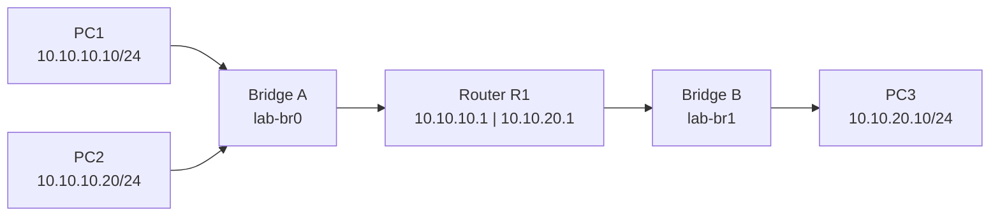

# linux-networking-homelab

Hands-on Linux networking labs on a single Ubuntu Server machine. Every network in this repository is built inside the Linux kernel, from network namespaces, virtual Ethernet pairs and bridges, then broken on purpose and diagnosed from evidence.

The labs cover switching, subnetting, routing, DNS, DHCP, packet capture, firewalls, VLAN trunks and traffic shaping, with Python used to verify network state rather than trust it.

## Hardware and software

- **Machine:** HP t740 thin client, 8 GB RAM, one Ethernet port
- **OS:** Ubuntu Server
- **Tools:** `iproute2`, `tcpdump`, `dnsmasq`, BusyBox `udhcpc`, `nftables`, `iperf3`, Python 3

No extra hardware, VMs or cloud account is needed. All lab interfaces are virtual.

## The lab network

The main topology grows over the first labs into two subnets joined by a router:



Each "PC" and the router are network namespaces; each "switch" is a Linux bridge. The VLAN lab uses its own separate VLAN-aware bridge.

## Labs and progress

| Lab | Topic | What it proves | Status |
|---|---|---|---|
| 0 | Baseline and safety | The physical interface and SSH route are identified and left untouched | Not started |
| 1 | Layer 2 LAN | Two namespaces ping each other through a virtual switch | Not started |
| 2 | Routing | A host in one subnet reaches a host in another through a router | Not started |
| 3 | DNS | A lab hostname resolves through the router's DNS server | Not started |
| 4 | DHCP | A client gets its address and gateway from a lab-only DHCP server | Not started |
| 5 | Packet capture | ARP, ICMP, DNS, DHCP and TCP identified in captured traffic | Not started |
| 6 | Firewall | One connection is blocked and restored without affecting the host | Not started |
| 7 | Python verification | Scripts check reachability and compare routing tables with expected state | Not started |
| 8 | VLANs | Access ports isolate hosts; a trunk and a router on a stick connect them | Not started |
| 9 | Traffic shaping | Measured throughput follows a configured `tc` rate in one direction | Not started |
| — | Capstone | Six injected faults diagnosed from evidence, then detected by Python | Not started |

The full instructions are in [`docs/lab-manual.md`](docs/lab-manual.md).

## Safety boundary

Everything is built with names starting with `lab-` (or `od-` for the Mini NaaS project) and never connects to the home network:

- The physical network interface is never moved, bridged or reconfigured.
- The host's default route and the home router are never changed.
- Firewall rules live inside the router namespace, not on the host.

The one exception is a host with Docker installed, where Docker's firewall rules can drop bridged lab traffic. The manual's section 0.3 explains how to test for that first and add a narrow exception only if a test proves one is needed.

## Repository layout

```text
docs/
├── lab-manual.md        # step-by-step labs, exercises and troubleshooting
└── mini-naas-plan.md    # design plan for the next project
```

Scripts from Labs 4 and 7, a lab journal and small packet captures will be added as each lab is completed.

## Next: Mini NaaS

Once the labs are done, the same machine becomes the test bed for **Mini NaaS**, a small Network-as-a-Service prototype. A FastAPI service accepts orders for point-to-point connections. A worker then provisions them as real VLANs and `tc` shapers, verifies them with pings and throughput tests, and records every change. It uses PostgreSQL for desired state and history, and Redis Streams for jobs.

The architecture, design decisions and phased roadmap are in [`docs/mini-naas-plan.md`](docs/mini-naas-plan.md). Implementation will live in its own repository. It is a learning prototype, not a production carrier network.

## About these documents

The lab manual and the Mini NaaS plan were written with AI assistance. The results, scripts and journal entries in this repository come from my own runs on the hardware above.
