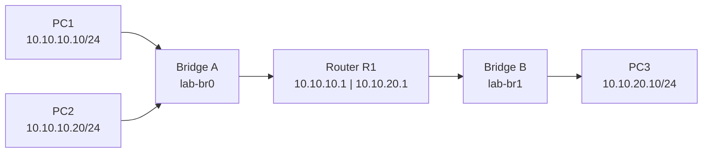

# Ubuntu Server Virtual Networking and Python Automation Lab Manual

*A detailed, isolated networking workbook for an HP t740 thin client*

**Prepared for:** Marek Zarzycki  
**Platform:** Ubuntu Server on HP t740, initially 8 GB RAM  
**Revision:** 30 October 2026 (adds VLAN trunks, traffic shaping, configuration validation and Docker notes)  
**Learning goal:** Understand switching, VLANs, TCP/IP, subnetting, routing, DNS, DHCP, packet inspection, firewalls, traffic shaping, and Python-based verification by building and breaking a small network.

## How to use this manual

This is a build-and-investigate workbook. Each lab starts from the previous lab's state unless it explicitly says otherwise. The commands create a network inside the Linux kernel, using names that begin with `lab-`. No command in the core exercises moves your physical Ethernet interface, changes the host's default route, changes the home router, or attaches the lab bridge to your home LAN. That boundary is deliberate: the Ubuntu host remains reachable over SSH even while an experiment is broken.

Commands are shown in a form that can be typed one at a time. The adjacent comments explain the immediate effect; the paragraphs following each block explain the design choice, alternatives, trade-offs, and what to inspect. Commands are not meant to be memorized. Run them slowly, predict the result before pressing Enter, and compare what you observe with the expected result.

**Important boundary:** A network namespace is not a full virtual machine. It provides a separate network stack, but the process still shares the host's filesystem and kernel. The lab deliberately runs privileged commands, so do not paste unfamiliar variants that refer to `eth0`, `enp...`, `wlan...`, `ufw`, a host firewall, or an existing bridge. Those could affect your SSH connection. If you intend to use this on a different Linux host, first check its existing interfaces and namespaces.

### Learning milestones

| Lab | What you build | Proof of success | Suggested effort |
|---|---|---|---|
| 0 | Baseline and safety inventory | You identify the physical interface and preserve a working SSH route | 30 minutes |
| 1 | Virtual Layer 2 LAN | Two isolated PCs ping through a virtual switch | 60 to 90 minutes |
| 2 | Two subnets and a router | A PC in subnet A pings a PC in subnet B | 90 to 120 minutes |
| 3 | Local DNS | `app.lab.test` resolves through the lab router | 60 to 90 minutes |
| 4 | DHCP | A virtual PC acquires its IP settings from a lab-only DHCP server | 90 to 120 minutes |
| 5 | Packet capture | You identify ARP, ICMP, DNS, DHCP, and TCP in captured traffic | 90 minutes |
| 6 | Firewall and failure diagnosis | You block and restore a specific connection without breaking host SSH | 60 to 90 minutes |
| 7 | Python verification | One Python program checks reachability, another checks routing configuration, and both report failures | 2 to 3 hours |
| 8 | VLAN access and trunk ports | Hosts on different VLANs are isolated, then reach each other only through a router on a trunk | 2 to 3 hours |
| 9 | Bandwidth shaping | Measured throughput follows a configured rate in one direction, then changes when the rate changes | 60 to 90 minutes |

The timing assumes you stop to inspect output and take notes. A lab is complete when you can explain *why* it works, not merely when a ping succeeds.

**Connection to the mini NaaS project:** Labs 7, 8 and 9 are the direct foundations of the separate project plan (`mini-naas-plan.md`). Lab 7's configuration check is the "observe" step of its engine, Lab 8's trunk ports and VLAN subinterfaces are its data plane, and Lab 9's token bucket filter is how it enforces bandwidth. Don't skip them.

## 0 Plan the environment and protect the home network

### 0.1 Why start with namespaces rather than Proxmox

Ubuntu Server already has the kernel features needed to simulate computers, Ethernet links, switches, and routers. A **network namespace** provides independent interfaces, IP addresses, routes and firewall rules. A **veth pair** has two linked ends, like an Ethernet patch cable. A **Linux bridge** forwards Ethernet frames, like a basic unmanaged Layer 2 switch. Combining them produces a useful network without running three operating systems.

| Option | Benefits | Costs or limitations | When to choose it |
|---|---|---|---|
| Network namespaces and bridges | Almost no extra RAM; exposes Linux networking directly; isolated and disposable | Primarily command line; no separate kernel or OS per PC | This workbook and initial fundamentals |
| Docker containers | Easy application packaging and reproducible environments | Docker hides some network details behind generated bridges and NAT | Later, when testing applications in distinct network segments |
| Multiple Ubuntu VMs in Proxmox | Realistic hosts, guest operating systems, graphical virtual networking | More RAM, disk, installation and administrative work | After the fundamentals, or when studying DHCP clients and server administration |
| Physical managed switch and router | Real hardware behavior, cables, port LEDs and VLAN tagging | Additional expense, power and chance of disrupting the household | Later, if you want hands-on physical switching |

**Decision:** Use namespaces first because the HP t740 can demonstrate routing and switching with 8 GB RAM. A larger SSD is useful for future VMs and captures, but not essential for the first labs. One physical Ethernet port is enough because all lab interfaces are virtual.

### 0.2 The network that will grow throughout the book

**Lab 1, one broadcast domain:** `lab-pc1` at `10.10.10.10/24` and `lab-pc2` at `10.10.10.20/24` connect to bridge `lab-br0`.

**Lab 2 onward, two routed networks:** retain the first two PCs and bridge. Add router namespace `lab-r1`, second bridge `lab-br1`, and `lab-pc3` at `10.10.20.10/24`. Router addresses are `10.10.10.1/24` and `10.10.20.1/24`. Later the router namespace also hosts DNS and DHCP.

**Lab 8, a separate VLAN switch:** a VLAN-aware bridge `lab-vbr` with its own endpoints, kept apart from the main lab so it cannot disturb it.

**Lab 9, back on the main lab:** traffic shaping is applied to R1's interfaces in the two-subnet topology above.

The full topology, rendered as a Mermaid diagram by GitHub and many Markdown editors:



These are **virtual kernel networking objects**, not physical boxes connected to the home router. Bridge A belongs to subnet `10.10.10.0/24`; Bridge B belongs to `10.10.20.0/24`. R1 is the only intended Layer 3 path between them.

The subnet addresses are examples from private RFC 1918 address space. They are intentionally unrelated to the typical home LAN `192.168.x.x`. This lowers the risk of accidentally mistaking a lab route for the home route. Isolation is nevertheless provided by the absence of a physical uplink, not by the choice of private address range.

### 0.3 Inspect before changing anything

```bash
# Show each existing interface in a compact format; do not change it.
ip -br address

# Show the host route used to reach the rest of your home network.
ip route

# Check whether another exercise already created lab namespaces.
ip netns list

# Check specifically for the bridge name this manual will use.
ip link show lab-br0

# Is Docker installed, and is it running? It can interfere with lab bridges.
command -v docker || echo "Docker not installed"
systemctl is-active docker

# Which firewall backend does Docker use? Only an explicit setting appears here.
grep -s firewall-backend /etc/docker/daemon.json || echo "no backend setting"

# Are bridged frames passed to the host firewall at all?
sysctl net.bridge.bridge-nf-call-iptables
```

**Line 1:** `ip` is Linux's network configuration utility. `-br` means brief; `address` lists addresses attached to interfaces. You are looking for a real device name such as `enp1s0`, its LAN IP address, and the `UP` state. We will not use that device name in later commands.

**Line 2:** `ip route` reveals the host's default gateway and directly connected networks. Record the default route so you know what should remain unchanged. It is read-only.

**Line 3:** `ip netns list` displays named network namespaces. An empty result is normal on a fresh server. If you see `lab-pc1`, `lab-pc2`, or `lab-r1`, stop: those names are already in use, and repeating creation commands will fail rather than safely overwrite them.

**Line 4:** `ip link show lab-br0` should say the device does not exist on a fresh setup. That error is an expected inventory result. Do not replace the name with your actual Ethernet device.

**Lines 5–6:** `command -v docker` prints Docker's path if it is installed; on a fresh Ubuntu Server it prints nothing and the `echo` runs instead. `systemctl is-active docker` prints `active` only if the Docker service is running.

**Line 7:** Docker's default firewall backend is iptables. Docker 29 added an experimental nftables backend, enabled with `"firewall-backend": "nftables"` in `/etc/docker/daemon.json`. If this command prints nothing but the `echo`, Docker (if installed) uses iptables.

**Line 8:** This reads one kernel setting. If it reports that the key does not exist, the `br_netfilter` module is not loaded, bridged frames never reach the host firewall, and Docker cannot affect the lab bridges. If it reports `1` and Docker is installed, read the Docker note below.

**Docker note: test first, change nothing preemptively.** With its default iptables backend, Docker sets the host firewall's `FORWARD` policy to `DROP` when it enables IP forwarding itself. When `br_netfilter` is loaded, frames crossing a Linux bridge in the host namespace can be passed through that chain, including frames crossing `lab-br0`, `lab-br1` and `lab-vbr`. The symptom is confusing: everything is configured correctly, yet even a same-subnet ping fails. This may or may not happen on your host, so don't modify the firewall in advance. The cleanest option is to finish this manual before installing Docker. If Docker is already installed:

1. **Identify** whether Docker is installed and running, and which backend it uses (the commands above).
2. **Build Lab 1 and run its ping test** (section 1.6). If it succeeds, Docker is not interfering; stop here.
3. **If the same-subnet ping fails**, rule out ordinary mistakes first with the checks in section 1.6 (interface state, addresses, bridge ports). Then inspect the forwarding rules. With the iptables backend:

   ```bash
   # Show the FORWARD policy and per-rule packet counters (read-only).
   sudo iptables -L FORWARD -v -n
   ```

   Run it, ping again, and run it once more. If the policy line says `DROP` and its packet counter grows with each ping, Docker's policy is dropping the lab's bridged frames.
4. **Only then, add one narrow exception** for that lab bridge, with the iptables backend:

   ```bash
   # Allow frames that enter and leave through the same lab bridge; nothing else.
   sudo iptables -I DOCKER-USER -i lab-br0 -o lab-br0 -j ACCEPT
   ```

   Docker processes the `DOCKER-USER` chain before its own forwarding rules, and for bridged frames `-i` and `-o` match the bridge's name, so this rule only affects traffic between ports of that one lab bridge. Repeat the test; repeat the same steps for `lab-br1` and `lab-vbr` only if their tests fail too. The rules disappear at reboot; to remove one sooner, repeat the command with `-D` instead of `-I`.

**With the nftables backend, do not use the `DOCKER-USER` command above.** That chain doesn't exist there, and Docker's documentation asks you to put your own rules in separate tables. Also, in nftables a drop in any table is final: an accept rule in your own table cannot override a drop elsewhere. If a lab test fails on such a host, read the full ruleset (`sudo nft list ruleset`) to find which chain drops the traffic, and consult Docker's nftables documentation before changing anything. If you previously ran Docker with the iptables backend, check `sudo iptables -L FORWARD -n` too: a `DROP` policy set back then can still be in place. When in doubt, run these labs on a host without Docker.

Bridges created *inside* a namespace, such as the mini NaaS project's provider bridge, are not affected by any of this, because each namespace has its own firewall tables.

If you are connected by SSH, keep that session open during the exercises. A second SSH session is useful for packet capture or a server that runs in the foreground. Do not change Ubuntu's Netplan files, systemd-networkd configuration, or UFW settings for these first labs.

### 0.4 Install only the tools we will need

```bash
# Refresh package metadata; this does not perform a general OS upgrade.
sudo apt update

# Network configuration, ping, packet capture, DNS queries and traceroute.
sudo apt install -y iproute2 iputils-ping tcpdump dnsutils traceroute

# A DNS/DHCP server binary without enabling a host-wide dnsmasq service.
sudo apt install -y dnsmasq-base busybox-static

# Firewall, HTTP client and Python tools for later exercises.
sudo apt install -y nftables curl python3 python3-venv

# Throughput measurement for the traffic-shaping lab.
sudo apt install -y iperf3
```

**Line 1:** `sudo` grants the required administrative permission. `apt update` refreshes the list of available packages; it does not upgrade every installed package. We deliberately avoid `apt upgrade` because an unrelated upgrade could restart services during a networking lesson.

**Line 2:** `iproute2` provides `ip` and related utilities; `iputils-ping` provides `ping`; `tcpdump` captures packets; `dnsutils` provides `dig`; `traceroute` helps examine packet paths. `-y` confirms package installation without repeated prompts. Omit `-y` if you prefer to approve the package list interactively.

**Line 3:** `dnsmasq-base` provides the dnsmasq executable without the normal system-service integration of the larger `dnsmasq` package. That matters because we want DNS and DHCP inside `lab-r1`, never a competing DHCP server on the household network. `busybox-static` provides `udhcpc`, a compact DHCP client we can start with a controlled configuration script.

**Line 4:** `nftables` provides the firewall command; `curl` tests HTTP connections; `python3` and `python3-venv` support our Python exercise. Installing the nftables package is different from enabling a host-wide firewall. The later rules will exist only in the router namespace.

**Line 5:** `iperf3` measures TCP throughput between a server and a client. If the installer asks whether to start iperf3 automatically as a daemon, answer **No**. We start it by hand, inside one namespace, only when a lab needs it.

**Trade-off:** A full DHCP client such as `dhclient` often runs configuration hooks that may alter resolver files. We use BusyBox's `udhcpc` with our own small hook script to control exactly what gets changed.

### 0.5 Understand the command grammar before beginning

Consider `sudo ip -n lab-pc1 address add 10.10.10.10/24 dev lab-p1`.

* `sudo` requests administrator permission; network interfaces and namespaces are privileged resources.
* `ip` is the utility that talks to the Linux kernel's networking subsystem.
* `-n lab-pc1` tells `ip` to operate inside that named namespace, not in the host network stack.
* `address add` means attach an IP address to an interface. `show` would inspect instead; `del` would remove.
* `10.10.10.10/24` is the host address plus prefix length. A `/24` contains 256 IPv4 addresses, of which 254 are conventionally usable for hosts in a normal LAN.
* `dev lab-p1` names the target interface. `dev` abbreviates device.

These distinctions explain why `sudo ip -n lab-pc1 ...` is safe within this lab but a careless `sudo ip address ...` on a real interface may not be.

## 1 Build a virtual switch and two computers

### 1.1 Create the Layer 2 switch

```bash
# Create an independent software Ethernet switch named lab-br0.
sudo ip link add lab-br0 type bridge

# Activate it so attached ports can forward frames.
sudo ip link set lab-br0 up
```

**Line 1:** `link add` asks the kernel to create a network device; `type bridge` selects Ethernet bridge behavior. `lab-br0` is just a deliberately distinctive name. It has no IP address because a simple switch forwards frames using MAC addresses, not IP routes.

**Line 2:** New virtual links normally start administratively down. `link set ... up` enables the bridge. Without it, the virtual endpoints can be correctly addressed yet unable to exchange frames.

**Alternative:** A direct veth pair would connect two PCs with no bridge. That is adequate for two endpoints but teaches nothing about a shared switch or forwarding table. We choose a bridge because it can accept more PCs later.

### 1.2 Create isolated network stacks

```bash
# Create the first virtual PC's networking environment.
sudo ip netns add lab-pc1

# Create a second, independent networking environment.
sudo ip netns add lab-pc2

# Confirm their names before attaching interfaces.
ip netns list
```

**Line 1:** `netns add` creates a named network namespace. The namespace initially contains a loopback device and no connection to the outside network. Its IP addresses and routes will be independent of the Ubuntu host.

**Line 2:** The second namespace gives us another endpoint. These are called PCs for learning convenience, but they are not full operating systems. A command such as `ip netns exec lab-pc1 ping ...` launches the host's `ping` program inside PC1's network context.

**Line 3:** Listing namespaces is a checkpoint. If one is missing, investigate before continuing; later commands depend on both names existing.

### 1.3 Make two virtual Ethernet cables

```bash
# Cable A: one end for the switch, the other for PC1.
sudo ip link add lab-s1 type veth peer name lab-p1

# Cable B: one end for the switch, the other for PC2.
sudo ip link add lab-s2 type veth peer name lab-p2

# Move the PC-facing cable ends into their separate namespaces.
sudo ip link set lab-p1 netns lab-pc1
sudo ip link set lab-p2 netns lab-pc2
```

**Line 1:** `type veth peer name` creates two interconnected Ethernet interfaces. Anything transmitted by one end reaches the other. `lab-s1` is the switch-facing end; `lab-p1` is the PC-facing end. The names themselves do not affect forwarding.

**Line 2:** Another veth pair gives PC2 a separate physical-looking connection. This is closer to two separate cables plugged into an Ethernet switch than sharing one software interface.

**Line 3:** Moving `lab-p1` into `lab-pc1` means it no longer appears in the host's ordinary `ip link` listing. You must inspect it using `ip -n lab-pc1 link`.

**Line 4:** The equivalent move gives PC2 ownership of `lab-p2`. The peer ends `lab-s1` and `lab-s2` remain in the host namespace, ready to attach to the bridge.

**Why not create complete VMs?** The kernel-level cable behaves like Ethernet without booting an OS. A VM is useful for learning server administration; it is unnecessary for understanding frames and routes.

### 1.4 Plug the cables into the switch

```bash
# Enslave both host-facing veth interfaces to the Linux bridge.
sudo ip link set lab-s1 master lab-br0
sudo ip link set lab-s2 master lab-br0

# Enable both switch ports; the bridge is already up.
sudo ip link set lab-s1 up
sudo ip link set lab-s2 up
```

**Lines 1 and 2:** `master lab-br0` connects each veth interface as a bridge port. The kernel bridge learns which MAC addresses are reachable behind each port. No IP address is assigned to the ports because they are carrying Layer 2 frames.

**Lines 3 and 4:** The switch-facing ends must be `up`. A veth pair works only when both ends are enabled, so we will also activate the PC ends in the next section.

### 1.5 Address and activate the computers

```bash
# Give PC1 its Layer 3 identity in subnet 10.10.10.0/24.
sudo ip -n lab-pc1 address add 10.10.10.10/24 dev lab-p1

# Give PC2 a different host address in the same subnet.
sudo ip -n lab-pc2 address add 10.10.10.20/24 dev lab-p2

# Activate PC1's Ethernet and loopback interfaces.
sudo ip -n lab-pc1 link set lab-p1 up
sudo ip -n lab-pc1 link set lo up

# Activate PC2's Ethernet and loopback interfaces.
sudo ip -n lab-pc2 link set lab-p2 up
sudo ip -n lab-pc2 link set lo up
```

**Line 1:** PC1 receives `.10/24`. The `/24` mask tells its kernel that `10.10.10.0` through `10.10.10.255` are on-link. In an ordinary `/24`, `.0` is the network address and `.255` is the broadcast address.

**Line 2:** PC2 receives `.20/24`, a distinct host address in the same network. Duplicating `.10` would cause an address conflict; assigning PC2 a different prefix could create an apparent routing problem even with a perfectly good switch.

**Lines 3 and 5:** These commands bring the virtual Ethernet interfaces up. IP configuration alone does not activate a down interface.

**Lines 4 and 6:** These activate loopback (`lo`) inside each namespace. Loopback is useful for local services and mirrors normal host initialization. We enable it explicitly because these namespaces do not run a full operating-system boot process.

**Why no default gateway?** Both PCs are on the same subnet. Each kernel installs a connected route automatically when its address is added, so neither needs to send traffic through a router to reach the other.

### 1.6 Verify the LAN instead of trusting the commands

```bash
# Check the addresses actually installed on each PC.
sudo ip -n lab-pc1 -br address
sudo ip -n lab-pc2 -br address

# Inspect PC1's routes; expect its connected 10.10.10.0/24 route.
sudo ip -n lab-pc1 route show

# Send three ICMP echo requests from PC1 to PC2.
sudo ip netns exec lab-pc1 ping -c 3 10.10.10.20

# Inspect address-to-MAC resolution after successful ping.
sudo ip -n lab-pc1 neigh show

# Inspect which MAC addresses the bridge learned on its ports.
bridge fdb show br lab-br0
```

**Lines 1 and 2:** `-br address` prints addresses in brief form inside each namespace. This catches wrong addresses or down interfaces before you diagnose routing.

**Line 3:** `route show` displays a route to `10.10.10.0/24` through `lab-p1`. You should not see a default gateway, and that is correct for this one-subnet lab.

**Line 4:** `ip netns exec` runs the `ping` application as though it belongs to PC1. `-c 3` stops after three packets; otherwise Linux ping continues until interrupted. A reply proves ICMP can cross the virtual Ethernet path.

**Line 5:** The neighbor table shows PC2's MAC address after ARP resolution. ARP maps a local IPv4 destination to a Layer 2 address. If there is no entry, generate traffic again; the cache is dynamic.

**Line 6:** `bridge fdb` shows the forwarding database, which associates learned MAC addresses with bridge ports. This is how the Layer 2 switch decides where to send ordinary unicast frames. Some entries represent local or permanent addresses; focus on learned entries after traffic.

**Success criterion:** PC1 receives three replies from `10.10.10.20`, the route is on-link, and PC1 learns a neighbor MAC address.

### 1.7 Exercises that make the mechanism visible

1. Predict whether PC1 can ping `10.10.10.99` when no device owns that address. Run the test and inspect the neighbor table. Explain why a missing ARP reply differs from a failed route.
2. Bring down PC2's Ethernet interface: `sudo ip -n lab-pc2 link set lab-p2 down`. Ping again. Describe the difference between an administratively down link and an incorrect IP address. Restore it using `sudo ip -n lab-pc2 link set lab-p2 up`.
3. Change PC2's IP to `10.10.11.20/24` with `address del` and `address add` scoped to `lab-pc2`. Predict whether PC1 can reach it without a router. Restore `10.10.10.20/24` before continuing.
4. Explain why a Linux bridge is comparable to a Layer 2 switch, and why it is not the same thing as a router or Azure VNet peering.

**Notebook questions:** Which device learns MAC addresses? Which device maintains the IP route? Why does the subnet mask influence whether a destination is considered local?

## 2 Add another subnet and a virtual router

### 2.1 What changes and why

The first lab had one **broadcast domain**. ARP requests could reach any port in `lab-br0`, and the two PCs exchanged frames directly. A router introduces a Layer 3 boundary. We will keep PC1 and PC2 on `10.10.10.0/24`, create `10.10.20.0/24` for PC3, and connect both networks to a router called `lab-r1`.

The router needs an address in each subnet: `10.10.10.1` for the first LAN and `10.10.20.1` for the second. Each PC needs a default gateway pointing to the router address in its own subnet. Finally, the router must be permitted to forward IPv4 packets. These are three different requirements; configuring only two is insufficient.

**Design alternative:** A Layer 3 switch could also route between VLANs. Here the router is a Linux namespace, which keeps the interfaces and routing table visible. We postpone VLAN configuration until the routing concept is clear.

### 2.2 Add the second switch and third PC

```bash
# Give the second subnet a different Layer 2 broadcast domain.
sudo ip link add lab-br1 type bridge
sudo ip link set lab-br1 up

# Create the new PC and the router's independent network stack.
sudo ip netns add lab-pc3
sudo ip netns add lab-r1

# Connect the new PC to the second switch with a veth pair.
sudo ip link add lab-s3 type veth peer name lab-p3
sudo ip link set lab-p3 netns lab-pc3
sudo ip link set lab-s3 master lab-br1
sudo ip link set lab-s3 up
```

**Line 1:** `lab-br1` is distinct from `lab-br0` because we want two separate Ethernet broadcast domains. Connecting all three PCs to the same bridge would obscure the distinction between switching and routing.

**Line 2:** The bridge is brought up so it can forward frames when ports are added.

**Line 3:** `lab-pc3` is a third endpoint; it will eventually host the destination service for DNS and HTTP exercises.

**Line 4:** `lab-r1` is the router namespace. It will have two interfaces and a route for each connected subnet. It will not have an uplink to the internet or your home LAN.

**Line 5:** `lab-s3` is the switch end; `lab-p3` is the PC end of the veth pair.

**Line 6:** Moving the endpoint into PC3 gives that namespace its own Ethernet device.

**Line 7:** `master lab-br1` plugs the switch end into the second bridge.

**Line 8:** The host-side port is activated. We will activate the PC side when assigning the IP address.

### 2.3 Connect both switches to the router

```bash
# Router cable A, connected to the first bridge.
sudo ip link add lab-ra-sw type veth peer name lab-r1a
sudo ip link set lab-r1a netns lab-r1
sudo ip link set lab-ra-sw master lab-br0
sudo ip link set lab-ra-sw up

# Router cable B, connected to the second bridge.
sudo ip link add lab-rb-sw type veth peer name lab-r1b
sudo ip link set lab-r1b netns lab-r1
sudo ip link set lab-rb-sw master lab-br1
sudo ip link set lab-rb-sw up
```

**Line 1:** The first router cable will connect `lab-r1` to subnet A. The naming scheme distinguishes the bridge-facing interface (`lab-ra-sw`) from the router-facing interface (`lab-r1a`).

**Line 2:** The router-facing interface moves into the router namespace, where its IP address and routes will be managed independently.

**Line 3:** The first cable is attached to `lab-br0`, the same Ethernet segment as PC1 and PC2.

**Line 4:** The switch end of this cable is enabled.

**Line 5:** A second, independent cable gives the router a way to reach subnet B. Routers connect multiple IP networks through different interfaces or VLAN subinterfaces.

**Line 6:** `lab-r1b` is moved into the *same* router namespace as `lab-r1a`, because a single router must see both interfaces in one routing table.

**Line 7:** Cable B is connected to the second bridge, not the first. Connecting it to the wrong bridge would defeat our intended Layer 2 separation.

**Line 8:** The second cable is activated.

### 2.4 Give the router and PC3 their addresses

```bash
# R1's gateway address on subnet A.
sudo ip -n lab-r1 address add 10.10.10.1/24 dev lab-r1a

# R1's gateway address on subnet B.
sudo ip -n lab-r1 address add 10.10.20.1/24 dev lab-r1b

# PC3 gets a host address in subnet B.
sudo ip -n lab-pc3 address add 10.10.20.10/24 dev lab-p3

# Activate R1's interfaces and loopback.
sudo ip -n lab-r1 link set lab-r1a up
sudo ip -n lab-r1 link set lab-r1b up
sudo ip -n lab-r1 link set lo up

# Activate PC3's interface and loopback.
sudo ip -n lab-pc3 link set lab-p3 up
sudo ip -n lab-pc3 link set lo up
```

**Line 1:** R1's `.1` address on subnet A will become the gateway for PC1 and PC2. Using `.1` is conventional, not mandatory; any free usable address in the subnet would work if the PCs were configured consistently.

**Line 2:** R1's `.1` address in subnet B will be PC3's gateway. A router must have a reachable next-hop address from the perspective of each connected client.

**Line 3:** PC3 receives `10.10.20.10/24`. Its prefix matches the router's subnet-B interface, so it can use local Ethernet and ARP to reach `10.10.20.1`.

**Lines 4 and 5:** Both router interfaces must be up; otherwise the corresponding connected route may be unusable.

**Line 6:** Loopback provides a normal local networking environment for future DNS and DHCP processes in the router namespace.

**Lines 7 and 8:** PC3's Ethernet and loopback interfaces are enabled. Each new namespace starts with interfaces down unless you activate them.

### 2.5 Configure the default gateways

```bash
# Subnet-A clients use R1's subnet-A interface as their next hop.
sudo ip -n lab-pc1 route add default via 10.10.10.1
sudo ip -n lab-pc2 route add default via 10.10.10.1

# Subnet-B client uses R1's subnet-B interface.
sudo ip -n lab-pc3 route add default via 10.10.20.1

# Display the resulting route tables.
sudo ip -n lab-pc1 route show
sudo ip -n lab-pc3 route show
sudo ip -n lab-r1 route show
```

**Lines 1 and 2:** `route add default` creates a catch-all route for destinations not matched by a more specific route. PC1 and PC2 already know how to reach their local `/24`. They need the router only for other networks. `via 10.10.10.1` identifies the next-hop gateway; the destination remains the ultimate destination, not the gateway itself.

**Line 3:** PC3 uses `10.10.20.1` as its default gateway. Pointing it at `10.10.10.1` would be wrong because that address is not directly reachable on PC3's Ethernet segment.

**Lines 4 and 5:** Inspect both PC routing tables. The on-link `/24` should coexist with a `default via ...` route. Linux selects a route according to the most specific matching prefix.

**Line 6:** R1 should already have two connected routes, one for each subnet, because it owns an interface in both. It does **not** require a default route to forward between these two directly connected networks.

**Alternative:** You could install only specific routes to the other subnet on each PC, such as `10.10.20.0/24 via 10.10.10.1`, rather than a default route. Specific routes are more restrictive and are worth practicing later. Default gateways are simpler for this first two-network topology.

### 2.6 Enable IPv4 forwarding only inside the router

```bash
# Read the current forwarding switch inside the router namespace.
sudo ip netns exec lab-r1 sysctl net.ipv4.ip_forward

# Permit the lab router to forward packets between its interfaces.
sudo ip netns exec lab-r1 sysctl -w net.ipv4.ip_forward=1

# Test the packet path from subnet A to subnet B.
sudo ip netns exec lab-pc1 ping -c 3 10.10.20.10

# Look at the hop sequence without DNS lookups.
sudo ip netns exec lab-pc1 traceroute -n -I 10.10.20.10
```

**Line 1:** `sysctl` reads a kernel setting inside R1. A value of `0` means Linux behaves like a host and generally does not forward transit IPv4 packets; `1` enables forwarding.

**Line 2:** `-w` writes the setting. Because we ran it using `ip netns exec lab-r1`, it affects the router namespace's network stack, not the host's IP forwarding setting. We deliberately avoid changing `/etc/sysctl.conf` or enabling host-wide forwarding.

**Line 3:** Ping now requires PC1 to send traffic to its gateway, R1 to forward it to subnet B, and PC3 to send a reply back through R1. If the reply succeeds, the forward and return paths are both working.

**Line 4:** `traceroute -I` uses ICMP probes; `-n` avoids reverse DNS lookups. The router should appear as an intermediate hop. Some implementations and timing conditions may show different output, so compare it with the route tables rather than relying only on traceroute.

**Success criterion:** PC1 pings PC3, while `lab-r1` has two connected routes and forwarding enabled. The Ubuntu host's own default route is unchanged.

### 2.7 Investigate deliberate routing failures

1. **No forwarding:** Set `sudo ip netns exec lab-r1 sysctl -w net.ipv4.ip_forward=0`, then ping PC3 from PC1. The interfaces and addresses still exist, but transit packets are no longer forwarded. Restore `=1` afterward.
2. **Wrong default gateway:** Inspect what happens if PC3's default route is temporarily deleted with `sudo ip -n lab-pc3 route del default`. PC1 may send an echo request to PC3, but PC3 lacks a route back to `10.10.10.10`. Restore it with `sudo ip -n lab-pc3 route add default via 10.10.20.1`.
3. **Connected versus routed traffic:** Show that PC1 can still ping PC2 while R1 forwarding is disabled. The packet never needs to cross R1.
4. **Longest-prefix rule:** Add a specific route in PC1 for `10.10.20.0/24` via `10.10.10.1` and compare it with the default route. Then delete the specific route. Explain why both work in this topology.

**Notebook questions:** Which node is responsible for ARP on subnet A? Does the router forward the same Ethernet frame it received, or create a new Ethernet frame for subnet B? Why must the return route exist?

## 3 Add a DNS server to the router

### 3.1 Why DNS comes after routing

IP connectivity and name resolution are separate problems. DNS translates a name such as `app.lab.test` into an IP address. It does not create a route to that address. A working IP ping with a failing DNS lookup points toward a naming or resolver problem; a successful DNS lookup with failed connectivity points toward routes, filters or the destination service.

We use a name under `.test`, a domain reserved for testing, rather than inventing a real public domain or using `.local`, which may interact with multicast DNS. We use `dnsmasq` because it is small and can also provide DHCP in Lab 4.

### 3.2 Run dnsmasq inside the router namespace

Open a second SSH terminal. Keep your first terminal for tests. In the second terminal, run:

```bash
sudo ip netns exec lab-r1 dnsmasq \
  --no-daemon \
  --no-resolv \
  --no-hosts \
  --interface=lab-r1a \
  --bind-interfaces \
  --address=/app.lab.test/10.10.20.10 \
  --log-queries
```

**Command prefix:** `sudo ip netns exec lab-r1 dnsmasq` starts the DNS server *inside* router R1's isolated network stack. Because the entire process is launched in the namespace, its listeners do not bind to the Ubuntu host's physical Ethernet interface.

**Option 1:** `--no-daemon` keeps dnsmasq in the foreground. Logs appear in this terminal, and Ctrl+C stops it. That is preferable for training to silently launching a background service that might be forgotten.

**Option 2:** `--no-resolv` prevents dnsmasq from reading the host's upstream DNS server list. We want a self-contained DNS experiment, not unexpected forwarding to your home router.

**Option 3:** `--no-hosts` stops automatic use of the host's `/etc/hosts` file. This makes our explicit test record the main source of the answer.

**Option 4:** `--interface=lab-r1a` limits the intended service to R1's subnet-A interface. That is the address PC1 can reach at `10.10.10.1`.

**Option 5:** `--bind-interfaces` makes dnsmasq bind the selected interface explicitly. It is useful when other DNS services exist in separate contexts and clarifies the isolation intent.

**Option 6:** `--address=/app.lab.test/10.10.20.10` tells dnsmasq to answer an A-record query for `app.lab.test` with the IP of PC3. It is a local static mapping, not a full authoritative zone or public DNS registration.

**Option 7:** `--log-queries` shows incoming DNS questions and answers so you can correlate client commands with server behavior.

**Why not BIND or PowerDNS?** Those are appropriate for richer DNS features, zones and authoritative service, but introduce more configuration before the basic DNS request-response exchange is clear. The book *Network Basics for Hackers* includes BIND work, so it is a useful later extension.

### 3.3 Query the lab DNS server explicitly

In your first terminal:

```bash
# Ask R1's DNS server directly; bypass the host's normal DNS configuration.
sudo ip netns exec lab-pc1 dig @10.10.10.1 app.lab.test A +short

# Try an invented name that has no explicit local record.
sudo ip netns exec lab-pc1 dig @10.10.10.1 missing.lab.test A

# Check that the resolved destination is actually reachable by IP.
sudo ip netns exec lab-pc1 ping -c 3 10.10.20.10
```

**Line 1:** `dig` is a DNS query tool. The `@10.10.10.1` syntax specifies *which DNS server* to ask, bypassing the namespace's normal resolver configuration. `A` asks for IPv4 address records; `+short` displays only the concise answer. Expect `10.10.20.10`.

**Line 2:** This asks for a nonexistent name. Compare the response status with the first query. With no forwarding and no matching local record, dnsmasq should not return our PC3 address. The precise status can depend on local dnsmasq options; inspect the full response rather than assuming every failure must be NXDOMAIN.

**Line 3:** Ping confirms routing to PC3 still works. Resolving a name proves only that DNS supplied an address, not that a service at that address is listening.

**Why not change `/etc/resolv.conf`?** Namespaces have their own network settings but generally share the host filesystem. Altering the wrong resolver file could affect the entire thin client. Explicit `dig @...` is a safer first demonstration. Later, you can learn `/etc/netns/NAME/resolv.conf` for per-namespace resolver configuration.

### 3.4 DNS challenges

1. Stop dnsmasq with Ctrl+C and repeat the DNS query. Confirm that direct IP connectivity can still succeed while DNS times out or refuses the query.
2. Restart dnsmasq with `--address=/app.lab.test/10.10.20.99`, then explain why the name resolves but the destination does not respond to ping. Restore `.10` afterward.
3. Observe how an A lookup differs from an AAAA lookup. We configured only an IPv4 mapping.
4. Explain the difference between a DNS record, an IP route, and an ARP entry.

**Checkpoint:** Stop this DNS-only dnsmasq process before Lab 4. We will replace it with one instance that offers both DNS and DHCP on the same isolated interface. Do not run two competing instances on the same interface and port.

## 4 Add DHCP with a controlled client

### 4.1 What DHCP will demonstrate

DHCP supplies an address and associated settings without manually typing them on each client. The typical initial exchange is Discover, Offer, Request, Acknowledge, often abbreviated DORA. DHCP uses broadcast traffic while a client has no usable IPv4 address, which is why the server must be on the same local segment or reachable through a DHCP relay.

Our server will hand out addresses from `10.10.10.100` through `10.10.10.150`. PC1 stays statically configured at `.10` and the router remains at `.1`; neither overlaps the pool. PC2 will temporarily stop using `.20` and request a dynamic address. The server will also advertise gateway `.1` and DNS server `.1`.

**Safety detail:** A normal desktop DHCP client may edit system resolver files or execute distro-specific configuration hooks. A namespace isolates networking state but not every filesystem operation. We therefore use a small, narrowly scoped client script instead of letting a default hook modify shared files.

### 4.2 Start the combined DNS and DHCP server

Make sure the DNS-only dnsmasq process from Lab 3 has stopped. In the second terminal:

```bash
sudo ip netns exec lab-r1 dnsmasq \
  --no-daemon \
  --no-resolv \
  --no-hosts \
  --interface=lab-r1a \
  --bind-interfaces \
  --address=/app.lab.test/10.10.20.10 \
  --dhcp-range=10.10.10.100,10.10.10.150,255.255.255.0,1h \
  --dhcp-leasefile=/tmp/lab-dnsmasq.leases \
  --dhcp-option=option:router,10.10.10.1 \
  --dhcp-option=option:dns-server,10.10.10.1 \
  --log-dhcp \
  --log-queries
```

**Prefix and first six options:** They have the same meanings as in Lab 3: isolated namespace, foreground logs, no host resolver or hosts file, binding to subnet A, and one explicit DNS name.

**DHCP range:** The three comma-separated values specify the first available address, last available address, and subnet mask. The final `1h` is a one-hour lease duration. A short lease is convenient for a lab; production networks choose lease lengths based on churn, address capacity and operational needs.

**Lease file:** `--dhcp-leasefile=/tmp/lab-dnsmasq.leases` deliberately moves the DHCP lease database away from dnsmasq's usual system path. Network namespaces still share the filesystem, so an explicit, uniquely named lab file is safer. The file remains after the virtual network is deleted and can be inspected or removed separately when the exercise is complete.

**Router option:** `option:router,10.10.10.1` advertises the client's default gateway. A DHCP address alone would let the client reach its local subnet, but not necessarily a remote one.

**DNS server option:** `option:dns-server,10.10.10.1` advertises the DNS resolver. We will not allow a generic DHCP hook to rewrite the host's resolver file; the value is still visible in the client negotiation.

**DHCP logging:** `--log-dhcp` reveals the offer and lease details so you can verify that the client was served by the intended lab router, not some unexpected source.

**Query logging:** `--log-queries` continues showing DNS activity from the earlier experiment.

### 4.3 Make PC2 an unconfigured DHCP client

In the first terminal:

```bash
# Remove only PC2's known static IPv4 address.
sudo ip -n lab-pc2 address del 10.10.10.20/24 dev lab-p2

# Remove its previously configured default route if one exists.
sudo ip -n lab-pc2 route del default

# Verify the interface is still up but lacks that IPv4 address.
sudo ip -n lab-pc2 -br address
```

**Line 1:** Deleting the address makes PC2 behave like a new machine awaiting DHCP. The command names `lab-pc2` and `lab-p2`, so it cannot remove the Ubuntu host's physical IP address. Do not substitute the host's interface name.

**Line 2:** A previous static default gateway should not remain after switching to dynamic configuration. If the command reports that no such route exists, that is a harmless state observation; continue after confirming the routing table.

**Line 3:** The interface should still be `UP` but no longer show `10.10.10.20/24`. DHCP can work over an enabled interface without an assigned IPv4 address.

### 4.4 First observe a lease without applying it

```bash
# Verify this BusyBox build contains the DHCP client applet.
busybox --list | grep '^udhcpc$'

# Request a lease but deliberately run a no-op configuration hook.
sudo ip netns exec lab-pc2 busybox udhcpc \
  -i lab-p2 -n -q -s /bin/true
```

**Line 1:** BusyBox packages many small Unix tools in one executable. We check that `udhcpc` is present rather than assume every distro build includes it. If it is missing, confirm that `busybox-static` installed correctly.

**Client command:** `ip netns exec lab-pc2` constrains the client to PC2's isolated network. `-i lab-p2` selects its virtual Ethernet interface; `-n` exits instead of retrying indefinitely if no lease is obtained; `-q` quits after receiving a lease; `-s /bin/true` invokes a script that intentionally does nothing to network configuration. The output should show a lease being offered or obtained, but `ip -n lab-pc2 address` will still show no assigned IPv4 address. That difference is instructive: receiving a DHCP reply and applying operating-system configuration are separate steps.

### 4.5 Apply the DHCP lease safely with a tiny script

Create a working folder and open the script in an editor:

```bash
# Keep teaching files in an ordinary user-owned folder.
mkdir -p "$HOME/network-lab"

# Open a new hook script; paste the listing below and save the file.
nano "$HOME/network-lab/lab-dhcp-client.sh"
```

**Line 1:** The directory contains your lab's own scripts. It is not an Ubuntu network configuration directory. `mkdir -p` creates it if absent and does not error if it already exists.

**Line 2:** `nano` opens a terminal text editor. Save with Ctrl+O and Enter; exit with Ctrl+X. You may use VS Code over SSH or another editor instead. We choose an explicit file so the DHCP client behavior is inspectable.

Paste this complete shell script:

```sh
#!/bin/sh
set -eu

case "$1" in
  bound|renew)
    [ "$interface" = "lab-p2" ] || exit 1
    prefix=$(python3 -c 'import ipaddress,os; print(ipaddress.IPv4Network("0.0.0.0/" + os.environ["subnet"]).prefixlen)')
    ip address flush dev "$interface"
    ip address add "$ip/$prefix" dev "$interface"
    if [ -n "${router:-}" ]; then
      set -- $router
      ip route replace default via "$1" dev "$interface"
    fi
    ;;
esac
```

**Shebang:** `#!/bin/sh` tells Linux to interpret the script with a standard POSIX shell, which is sufficient here.

**Safety setting:** `set -e` stops on an unhandled command failure; `-u` rejects unset variables. These help reveal mistakes instead of silently continuing with partial configuration.

**Event selection:** `case "$1" in` examines the event passed by `udhcpc`. We only modify configuration for successful `bound` or `renew` events; initial `deconfig` calls do nothing.

**Interface guard:** `[ "$interface" = "lab-p2" ] || exit 1` refuses to configure any interface other than the virtual PC2 interface. The variable is supplied by `udhcpc`; this guard is intentionally narrower than a general-purpose DHCP script.

**Subnet conversion:** The one-line Python expression reads the DHCP subnet mask from the `subnet` environment variable and converts it to prefix length using `ipaddress`. For `255.255.255.0`, the result is `24`. We do this rather than hardcode `/24` so the script uses the server-advertised mask.

**Address replacement:** `ip address flush dev "$interface"` removes addresses from PC2's lab interface. Because the entire DHCP process runs in `lab-pc2`, this operates in PC2's network namespace. **Never run this script directly on the host**, where it would not have the same isolation. The next line assigns the DHCP-offered `$ip` with the calculated prefix.

**Router check:** `if [ -n "${router:-}" ]` checks whether DHCP supplied a nonempty router option. Some networks intentionally provide no default gateway.

**Select first gateway:** `set -- $router` turns a whitespace-separated list of routers into positional arguments; `$1` becomes the first offered gateway. This simple lab uses one router and assumes trusted lab DHCP data.

**Install gateway:** `ip route replace default via "$1" dev "$interface"` adds or updates the default route within PC2's namespace. `replace` avoids failing if a default route already exists.

**Closure:** `fi`, `;;`, and `esac` close the conditional and event case. Other DHCP events fall through without changing the network.

Activate the script and run the DHCP client:

```bash
# Make the file executable for the DHCP client's hook mechanism.
chmod +x "$HOME/network-lab/lab-dhcp-client.sh"

# Obtain the lease and apply it only within PC2's network namespace.
sudo ip netns exec lab-pc2 busybox udhcpc \
  -i lab-p2 -n -q -s "$HOME/network-lab/lab-dhcp-client.sh"

# Inspect what the script actually installed.
sudo ip -n lab-pc2 -br address
sudo ip -n lab-pc2 route show
```

**Line 1:** `chmod +x` permits the DHCP client to execute your script. It does not change network configuration.

**Client line:** The selected DHCP interface, finite-retry behavior and quit-on-success behavior are unchanged; only the hook changes from `/bin/true` to your script. The shell expands `$HOME` before `sudo` runs, so the absolute script path remains available inside the namespace's shared filesystem.

**Final two lines:** Inspect both the assigned IPv4 address and default route. Expect an address in `10.10.10.100-150` with `/24` and a default route via `10.10.10.1`. The exact leased address is dynamic; do not assume it will always be `.100`.

**Restore for predictable later labs:** After completing the DHCP exercises, remove the DHCP-assigned address identified by `ip -n lab-pc2 -br address`, then restore `10.10.10.20/24` and its default route via `10.10.10.1`. For example, if the client received `.100`, use `sudo ip -n lab-pc2 address del 10.10.10.100/24 dev lab-p2`, followed by `address add 10.10.10.20/24` and `route replace default via 10.10.10.1`. Substitute the *observed* lease address rather than copying `.100` blindly.

### 4.6 DHCP exercises

1. Explain which device receives the DHCP broadcast and why the server can answer without any physical Ethernet connection.
2. Shorten the pool to `.100` through `.105` and predict how many distinct addresses it can lease. Do not overlap static infrastructure addresses.
3. Start a packet capture before the DHCP client. Identify Discover, Offer, Request and Acknowledge, including UDP ports 67 and 68.
4. Intentionally stop dnsmasq and run `udhcpc -n`. Explain why the client cannot obtain an address. Start dnsmasq again and retry.
5. Change the advertised DNS server to `10.10.10.99` and observe what the DHCP client receives. Why might IP connectivity still work while name resolution fails? Restore `.1` afterward.

**Checkpoint:** Leave the combined dnsmasq running for packet-capture exercises. Stop it with Ctrl+C when you no longer need DNS or DHCP.

## 5 See the packets rather than only the results

### 5.1 Why packet inspection changes how you troubleshoot

Ping says whether an ICMP exchange succeeded. It does not tell you whether failure occurred in ARP, routing, DNS, DHCP, or a firewall. Packet capture shows the actual frames or packets traversing an interface. We will use `tcpdump` inside a namespace so the capture sees exactly the interface we care about.

Do not start by capturing your household Ethernet interface. Capturing `lab-r1a` avoids unrelated family traffic, makes analysis much simpler, and keeps the exercise scoped to your own virtual network.

### 5.2 Watch ICMP crossing the router

Open a second terminal and run:

```bash
# Capture ICMP packets on the router's subnet-A interface.
sudo ip netns exec lab-r1 tcpdump -n -i lab-r1a -c 6 icmp
```

**`ip netns exec lab-r1`:** Runs the packet capture in R1. This allows `tcpdump` to see the router-facing interface `lab-r1a`, which does not exist in the host's interface list.

**`-n`:** Avoids DNS lookups of observed addresses. Network diagnosis is clearer when you see raw IP values; DNS lookups could introduce unrelated packets or delays.

**`-i lab-r1a`:** Selects the exact capture interface. Capturing on the wrong router side would show a different Ethernet segment. Later, repeat on `lab-r1b` to compare packet paths.

**`-c 6`:** Stops after capturing six matching packets. Three successful pings normally generate six matching echo request/reply packets at that interface. If fewer packets arrive, Ctrl+C stops the capture manually.

**`icmp`:** A Berkeley Packet Filter expression that limits the capture to ICMP. Without a filter you would also see ARP, DNS and other traffic.

In the first terminal:

```bash
# Generate a short, known sequence of traffic.
sudo ip netns exec lab-pc1 ping -c 3 10.10.20.10
```

Compare the source and destination addresses of requests and replies. Then repeat the capture on `lab-r1b`. The IP addresses remain the same as the packets cross the router, but the Ethernet MAC addresses on the two segments differ. That is a fundamental distinction between Layer 2 forwarding and Layer 3 routing.

### 5.3 Capture DNS or DHCP into a file

```bash
# Write DNS traffic from R1's subnet-A interface to a packet-capture file.
sudo ip netns exec lab-r1 tcpdump -n -i lab-r1a \
  -w /tmp/lab-dns.pcap 'udp port 53'
```

**`-w /tmp/lab-dns.pcap`:** Writes packets in a format Wireshark can open later rather than printing a textual summary. The file is in the shared filesystem at `/tmp`, but the capture interface is inside the namespace. We use a deliberately unique filename rather than overwriting an arbitrary capture.

**`'udp port 53'`:** Selects traditional UDP DNS packets. DNS can also use TCP port 53, so this filter is intentionally narrow for the first exercise. It will not show every possible DNS transport, including encrypted DNS variants.

While this command runs, issue the `dig @10.10.10.1` query from Lab 3, then stop the capture with Ctrl+C. Read it locally with `sudo tcpdump -nn -r /tmp/lab-dns.pcap`. `-r` reads a file rather than a live interface; `-nn` disables both host and service-name resolution.

If you want a graphical view on your laptop, copy the file over SSH (replace the placeholders with your actual Linux username and thin client's home-LAN IP address):

```bash
scp YOUR_USER@THIN_CLIENT_IP:/tmp/lab-dns.pcap .
```

The command is run **on the laptop**. `scp` securely transfers the capture to the current laptop directory. If the file is root-owned and unreadable, explicitly adjust permission on this known lab file or copy it to a user-owned location first; do not change permissions recursively in `/tmp`.

To inspect DHCP, repeat the capture with `'(udp port 67 or udp port 68)'`, then initiate a new `udhcpc` request from PC2. You should be able to recognize the DHCP message sequence and inspect the offered address, gateway and DNS server.

### 5.4 Packet analysis challenges

1. Capture ARP with `tcpdump -e -n -i lab-p1 arp` inside PC1. Why is the destination Ethernet address a broadcast when the sender does not know PC2's MAC address?
2. Capture ICMP on both R1 interfaces and compare Ethernet source/destination MAC addresses. Which values change as routing occurs, and which IP addresses remain stable?
3. Capture a DNS request and response. Identify the query name, query type, response address and UDP port numbers.
4. Capture DHCP and identify the offered gateway and lease duration. Explain why DHCP is a Layer 7 service carried by UDP and Ethernet broadcasts during initial address acquisition.
5. Use `tcpdump` to distinguish **no request reaching the server** from **request received but no answer returned**.

**Alternative:** Wireshark has a richer graphical protocol decoder and is excellent for learning. `tcpdump` is often faster on a headless server, and saved `.pcap` files can be analyzed in Wireshark later. The tools complement each other.

## 6 Filter traffic and diagnose a firewall problem

### 6.1 Why nftables and why inside R1

Routers often enforce communication policies between network segments. Linux's nftables framework can inspect packets at the forwarding hook. We will create one table and one chain inside `lab-r1`, then block a narrow TCP flow. The host's UFW configuration and SSH connection remain untouched.

We choose a default `accept` policy for the demonstration so the only denied traffic is the deliberately added rule. Production firewalls may use default-deny policies after explicitly allowing required traffic, but that is a separate design exercise.

### 6.2 Start a harmless HTTP service on PC3

Use a new terminal for the web server:

```bash
# Create an intentionally empty document root, not your home folder.
mkdir -p "$HOME/network-lab/web-root"

# Serve only that directory, bound to PC3's isolated lab address.
sudo ip netns exec lab-pc3 python3 -m http.server 8000 \
  --bind 10.10.20.10 --directory "$HOME/network-lab/web-root"
```

**Line 1:** An HTTP server serves files from its document root. Giving it a dedicated empty directory avoids accidentally exposing personal project files from your home folder, even within the lab.

**Line 2:** `python3 -m http.server` launches Python's basic static HTTP server. Port `8000` is an unprivileged example port; `--bind 10.10.20.10` restricts listening to PC3's lab address; `--directory` selects the empty folder. `ip netns exec lab-pc3` ensures the server does not listen on the Ubuntu host's home-LAN interface. It is a demonstration server, not suitable for production exposure. Stop it with Ctrl+C after the exercise.

From PC1, run:

```bash
# Make an HTTP request across R1 to PC3.
sudo ip netns exec lab-pc1 curl -I --connect-timeout 3 \
  http://10.10.20.10:8000/
```

`curl -I` requests response headers; `--connect-timeout 3` avoids waiting indefinitely if the connection fails. Expect an HTTP response, often `200 OK` for the empty directory listing. The exact headers can differ by Python version.

### 6.3 Create a forward-chain firewall rule

```bash
# Create a table that exists only in the router namespace.
sudo ip netns exec lab-r1 nft add table inet lab_filter

# Attach a forward chain; start with policy accept for predictable tests.
sudo ip netns exec lab-r1 nft \
  'add chain inet lab_filter forward { type filter hook forward priority 0; policy accept; }'

# Drop only TCP traffic from subnet A toward PC3's demo HTTP port.
sudo ip netns exec lab-r1 nft add rule inet lab_filter forward \
  ip saddr 10.10.10.0/24 ip daddr 10.10.20.10 tcp dport 8000 drop

# Read the exact rule set that now exists in the router namespace.
sudo ip netns exec lab-r1 nft list ruleset
```

**Line 1:** `nft add table inet lab_filter` creates a named rules container in the `inet` family, which can handle IPv4 and IPv6 traffic. Because the command runs in `lab-r1`, it does not add a rule to the Ubuntu host firewall.

**Line 2:** A *base chain* registered at hook `forward` sees packets that R1 routes between interfaces. `type filter` means filtering rather than NAT; `priority 0` is the standard filter priority; `policy accept` allows packets unless a matching rule drops them. The braces and semicolons are quoted so the shell passes them intact to nftables.

**Line 3:** The rule matches source addresses in subnet A, destination `10.10.20.10`, TCP destination port `8000`, then silently drops the packet. It is deliberately precise. `drop` normally causes a client timeout; `reject` would return an explicit error, which can be easier to diagnose but reveals more information.

**Line 4:** `list ruleset` is read-only. Always inspect a firewall change instead of assuming the syntax created the rule you intended.

Repeat the `curl` test from PC1. It should now fail to connect. Meanwhile, an ICMP ping may still succeed because the rule only matches TCP destination port 8000. This shows why 'ping works' does not prove that an application port is allowed.

### 6.4 Remove the test firewall and prove recovery

```bash
# Delete only the named table created for this isolated exercise.
sudo ip netns exec lab-r1 nft delete table inet lab_filter

# The HTTP request should succeed again without restarting the server.
sudo ip netns exec lab-pc1 curl -I --connect-timeout 3 \
  http://10.10.20.10:8000/
```

**Line 1:** This is a scoped cleanup: only `lab_filter` inside `lab-r1` is deleted. We avoid `nft flush ruleset`, which would be unnecessarily broad and dangerous if run in the wrong namespace.

**Line 2:** The final `curl` is a regression check. A successful response indicates that the test firewall rule caused the earlier failure.

### 6.5 Firewall exercises

1. Predict the results of ping, DNS lookup and HTTP after adding the TCP 8000 drop rule. Test each separately.
2. Change `drop` to `reject` in a new controlled rule and compare the client's visible error. Remove the test rule afterward.
3. Introduce a port-specific allow rule and a broader drop rule in the same chain. Inspect rule order and counters, then explain why order can change the outcome.
4. Compare a forward-chain rule with an input-chain rule. A request *to the router's own DNS server* is local input, while a request routed between PCs uses forwarding.
5. Map the exercise conceptually to Azure NSGs, but remember that Linux nftables syntax and Azure NSG evaluation are not identical.

## 7 Automate network checks with Python

### 7.1 Start with read-only validation, not configuration changes

Python is most valuable when it can express an expected network state and check whether reality matches. That is safer and more transferable than immediately writing a script that reconfigures every interface. We will automate two questions: Are the expected namespaces present, and can selected endpoints reach their destinations?

**Design choice:** Use Python's standard-library `subprocess` rather than Netmiko or Nornir at first. Netmiko is primarily designed to connect to network devices over SSH; our lab devices are local Linux namespaces. Once you start using Cisco or Juniper virtual devices, Netmiko, Nornir and pyATS become more relevant.

### 7.2 Write a reachability checker

Create `"$HOME/network-lab/check_network.py"` with this content:

```python
#!/usr/bin/env python3
import json
import subprocess
import sys

CHECKS = [
    ("PC1 to PC2 on one LAN", "lab-pc1", "10.10.10.20"),
    ("PC1 to PC3 through R1", "lab-pc1", "10.10.20.10"),
    ("PC3 to PC1 return path", "lab-pc3", "10.10.10.10"),
]

def run_command(arguments):
    return subprocess.run(arguments, capture_output=True, text=True)

def check_ping(label, namespace, target):
    command = ["ip", "netns", "exec", namespace, "ping", "-n", "-c", "2", "-W", "1", target]
    result = run_command(command)
    return {"check": label, "passed": result.returncode == 0, "target": target}

def main():
    results = [check_ping(*item) for item in CHECKS]
    print(json.dumps(results, indent=2))
    failures = sum(not result["passed"] for result in results)
    return 0 if failures == 0 else 1

if __name__ == "__main__":
    sys.exit(main())
```

**Shebang:** Indicates Python 3 when the script is run as an executable. Invoking `python3 file.py` also works without using the shebang.

**Imports:** `json` formats structured results; `subprocess` starts other programs safely without a shell; `sys` lets the script return an exit status to CI or another calling process.

**CHECKS:** Each tuple stores a human-readable label, source namespace and target IP. Separating data from the check function makes it easy to add another scenario without duplicating code.

**`run_command`:** Calls a program with an argument list rather than constructing one shell string. `capture_output=True` captures stdout and stderr; `text=True` decodes them to Python strings. This avoids shell interpolation and makes later error reporting easier.

**`check_ping`:** Assembles a command that runs ping in a selected namespace. `-n` disables name lookups, `-c 2` sends two packets, and `-W 1` gives a one-second timeout for each reply on the commonly used Linux `ping` utility. `result.returncode == 0` indicates the command reported success. We return structured data rather than printing from deep inside the check.

**`main`:** Runs all checks, prints JSON and counts failures. A zero exit code means every check passed; nonzero allows a CI pipeline to mark the test as failed. The code is intentionally read-only: no route, address or firewall configuration is changed.

**Entry point:** `if __name__ == "__main__"` makes the code run as a command-line program while allowing its functions to be imported into tests. `sys.exit(main())` passes the success/failure status to the operating system.

Run it:

```bash
# Run as root because entering named network namespaces requires privilege.
sudo python3 "$HOME/network-lab/check_network.py"

# Inspect the exit status of the command that just completed.
echo $?
```

**Line 1:** `sudo` allows the script to enter each namespace. Do not give a web application unrestricted sudo access to this command; this is for local, trusted CLI use on your own lab.

**Line 2:** `$?` is the shell exit status of the previous command. Expect `0` if all checks pass and `1` if one or more fail.

**Why JSON?** Other programs can parse it reliably. If you later expose the result through FastAPI, send it to a monitoring dashboard, or save it in PostgreSQL, the core check logic can remain unchanged.

### 7.3 Test that the script notices failures

1. Disable forwarding in R1. The two same-subnet PCs should still pass; routed checks should fail. Re-enable forwarding.
2. Bring `lab-p3` down. Both checks involving PC3 should fail. Restore the interface.
3. Temporarily make the destination in one `CHECKS` tuple invalid. Confirm the JSON output identifies that check.
4. Add a new check from PC2 to PC3. Explain why it reuses the same function.
5. Improve the program to include captured `stderr`, duration and a timeout at the `subprocess.run` level. Explain why a program-level timeout is useful even when `ping` has a packet timeout.

### 7.4 Validate configuration from structured output

The reachability checker answers "does traffic flow?". It cannot say *why* it doesn't. A second kind of check compares the configuration you expect with the configuration the kernel actually has. Network automation tools do both: they observe state, compare it with the intended state, and only then test behavior.

Most `ip` commands accept `-j` to print JSON instead of text. Compare the two forms first:

```bash
# Human-readable routing table inside R1.
sudo ip -n lab-r1 route show

# The same table as JSON, which a program can parse without guessing at columns.
sudo ip -j -n lab-r1 route show
```

**Line 1:** The familiar text output. Its layout is designed for people and can change between versions.

**Line 2:** `-j` prints a JSON list with one object per route. Each object has keys such as `dst` (destination, or `default` for the default route), `dev` (outgoing interface) and `gateway` (next hop, absent for connected routes). Parsing this is reliable; parsing the text version with string splitting is fragile.

Create `"$HOME/network-lab/check_routes.py"`:

```python
#!/usr/bin/env python3
"""Compare each namespace's real routing table with the routes it should have."""
import json
import subprocess
import sys

# namespace -> list of (destination, device, gateway or None)
EXPECTED = {
    "lab-r1": [
        ("10.10.10.0/24", "lab-r1a", None),
        ("10.10.20.0/24", "lab-r1b", None),
    ],
    "lab-pc1": [
        ("10.10.10.0/24", "lab-p1", None),
        ("default", "lab-p1", "10.10.10.1"),
    ],
    "lab-pc3": [
        ("10.10.20.0/24", "lab-p3", None),
        ("default", "lab-p3", "10.10.20.1"),
    ],
}


def observed_routes(namespace):
    """Return {destination: route} parsed from ip's JSON output."""
    result = subprocess.run(
        ["ip", "-j", "-n", namespace, "route", "show"],
        capture_output=True, text=True, check=True,
    )
    return {route["dst"]: route for route in json.loads(result.stdout)}


def compare(namespace, expected, actual):
    problems = []
    for destination, device, gateway in expected:
        route = actual.get(destination)
        if route is None:
            problems.append(f"{namespace}: missing route {destination}")
            continue
        if route.get("dev") != device:
            problems.append(f"{namespace}: {destination} uses {route.get('dev')}, expected {device}")
        if route.get("gateway") != gateway:
            problems.append(f"{namespace}: {destination} via {route.get('gateway')}, expected {gateway}")
    return problems


def main():
    problems = []
    for namespace, expected in EXPECTED.items():
        problems += compare(namespace, expected, observed_routes(namespace))
    print(json.dumps({"passed": not problems, "problems": problems}, indent=2))
    return 0 if not problems else 1


if __name__ == "__main__":
    sys.exit(main())
```

**EXPECTED:** The intended state, written as data rather than code. Each entry names a destination, the interface it must use and, for routes through a router, the gateway. Keeping this separate from the logic means you can later load it from a YAML or JSON file without touching the comparison code.

**`observed_routes`:** Runs `ip -j -n NAMESPACE route show` with an argument list (no shell) and `check=True`, which raises an exception if `ip` fails, for example because the namespace doesn't exist. It turns the JSON list into a dictionary keyed by destination, so lookups are direct.

**`compare`:** A pure function: it receives data and returns a list of problems, without running commands. Pure functions are easy to test, because you can call them with hand-made dictionaries instead of a real kernel. It reports three kinds of difference: a missing route, the wrong interface, and the wrong gateway.

**`main`:** Collects problems across all namespaces, prints one JSON report and returns `0` when everything matches, `1` otherwise, exactly like the reachability checker.

Run it:

```bash
sudo python3 "$HOME/network-lab/check_routes.py"
echo $?
```

Expect `"passed": true` and exit status `0`.

**Exercises:**

1. Delete PC3's default route (`sudo ip -n lab-pc3 route del default`). Run both checkers. The reachability checker reports *that* PC1 cannot reach PC3; the configuration checker reports *why*: `lab-pc3: missing route default`. Restore the route.
2. Point PC1's default route at the wrong gateway with `sudo ip -n lab-pc1 route replace default via 10.10.10.20`. Predict the configuration checker's message before running it. Restore with `route replace default via 10.10.10.1`.
3. Add a check that R1 has forwarding enabled. Read it with `ip netns exec lab-r1 sysctl -n net.ipv4.ip_forward` and expect `1`. Disable forwarding and confirm your check fails.
4. Write two unit tests for `compare` that pass hand-made dictionaries, one where everything matches and one with a wrong gateway. They should run without `sudo`, because `compare` never touches the kernel.
5. Move `EXPECTED` into a YAML or JSON file and load it at startup. You have now separated *desired state* from the program that checks it, the core idea behind the mini NaaS project's engine.

**Why both checkers?** Behavior checks (ping) catch problems you didn't think to describe, such as a link that is down. Configuration checks explain failures precisely and catch problems that don't break traffic *yet*, such as a wrong backup route. Mature automation runs both.

### 7.5 Further Python projects

**Subnet calculator:** Use `ipaddress.ip_network` and `ipaddress.ip_interface` to report network address, broadcast address, first and last conventional usable hosts, mask and address count. Be careful with `/31` and `/32`: point-to-point and host-route behavior differs from the familiar `/24` case.

**Wider configuration validator:** Extend `check_routes.py` with addresses (`ip -j -n NAME address show`), link state (`ip -j -n NAME link show`) and, after Lab 8, VLAN membership (`bridge -j vlan show`).

**Packet analyzer:** Use Scapy to read saved `.pcap` files and count packets by protocol or identify DNS question names. Start by analyzing files, not by generating or sending packets on the home LAN.

**Network change testing:** Apply a change to the isolated router, run read-only assertions, and revert if the assertions fail. A production-grade version requires approval, transaction boundaries, logging, credentials management and rollback design.

## 8 VLAN access and trunk ports on a separate virtual switch

### 8.1 The reason for a separate VLAN lab

A VLAN isolates Ethernet broadcast domains even when devices connect to the same physical or virtual switch. Assigning two ports to different VLANs prevents them from exchanging ordinary Layer 2 frames unless routing or bridging between VLANs is configured. We build this exercise on its own bridge so it cannot interfere with Labs 1 through 7.

The lab has three parts. First, **access ports**: each port belongs to one VLAN and its frames travel untagged. Second, a **trunk port**: one port carries several VLANs at once, and each frame carries an 802.1Q tag that says which VLAN it belongs to. Third, a **router on a stick**: a router connected by that single trunk routes between the VLANs.

Trunks matter far beyond this lab. A switch uplink, a server running many networks, and a carrier's handover to a business customer all carry several VLANs over one cable. In the mini NaaS project, every provider port is a trunk and every connection is a VLAN on it.

### 8.2 Create two VLAN-isolated ports

```bash
# Create a new bridge with VLAN filtering and no automatic VLAN 1 PVID.
sudo ip link add lab-vbr type bridge vlan_filtering 1 vlan_default_pvid 0
sudo ip link set lab-vbr up

# Create two new network namespaces for the VLAN experiment.
sudo ip netns add lab-v10
sudo ip netns add lab-v20

# Create a cable for each VLAN endpoint.
sudo ip link add lab-vs10 type veth peer name lab-vp10
sudo ip link add lab-vs20 type veth peer name lab-vp20

# Move each endpoint-facing cable end into its namespace.
sudo ip link set lab-vp10 netns lab-v10
sudo ip link set lab-vp20 netns lab-v20

# Attach the remaining ports to the VLAN-aware bridge.
sudo ip link set lab-vs10 master lab-vbr
sudo ip link set lab-vs20 master lab-vbr

# Treat each bridge port as an untagged access port for its VLAN.
sudo bridge vlan add dev lab-vs10 vid 10 pvid untagged
sudo bridge vlan add dev lab-vs20 vid 20 pvid untagged

# Activate all cable ends.
sudo ip link set lab-vs10 up
sudo ip link set lab-vs20 up
sudo ip -n lab-v10 link set lab-vp10 up
sudo ip -n lab-v20 link set lab-vp20 up
```

**Bridge creation:** `vlan_filtering 1` makes the switch VLAN-aware; `vlan_default_pvid 0` avoids automatically assigning every port to VLAN 1. Without VLAN filtering, a plain bridge would forward both PCs' frames in the same broadcast domain.

**Bridge activation:** As in Lab 1, the bridge must be up to forward frames.

**Namespace creation:** `lab-v10` and `lab-v20` represent two independent endpoints. Their separate names avoid collision with the earlier PC and router namespaces.

**Veth creation:** Each command makes a two-ended cable, not a VLAN by itself. A cable only becomes a bridge port after its switch-facing end is attached to the bridge.

**Namespace moves:** Each endpoint-facing interface moves into its own network stack. The bridge-facing interfaces stay in the host namespace so the switch can manage them.

**Bridge attachment:** The `master lab-vbr` commands make both veth interfaces members of one VLAN-aware switch.

**VLAN assignments:** `bridge vlan add ... vid 10 pvid untagged` sets an access port for VLAN 10. `vid` is the VLAN ID; `pvid` assigns untagged incoming frames to that VLAN; `untagged` strips the tag on egress. The second port belongs to VLAN 20. They now share hardware-like switch infrastructure but not one Layer 2 broadcast domain.

**Activation:** Both ends of both veth pairs must be up. The loopback interfaces are optional for this simple ping test; activate them if you later start local services.

Give the two endpoints IP addresses in the *same* subnet to prove that VLAN isolation is separate from IP prefix configuration:

```bash
sudo ip -n lab-v10 address add 10.10.30.10/24 dev lab-vp10
sudo ip -n lab-v20 address add 10.10.30.20/24 dev lab-vp20

# Inspect VLAN membership and test that isolation prevents ping.
bridge vlan show
sudo ip netns exec lab-v10 ping -c 3 -W 1 10.10.30.20
```

**Address lines:** The two PCs have compatible IP ranges. If they still cannot communicate, the reason is not subnet arithmetic; VLAN isolation prevents ARP frames from crossing between the ports.

**Inspection:** `bridge vlan show` lists port-to-VLAN mapping. Confirm port 10 is not in VLAN 20 and vice versa.

**Ping:** The ping should fail because the VLANs are separate Layer 2 domains. This is a teaching exercise: placing the same IP subnet in two disconnected VLANs is intentionally unusual and should not become a production design.

As an experiment, move the second switch port into VLAN 10:

```bash
# Remove VLAN 20 from the second port and assign VLAN 10 instead.
sudo bridge vlan del dev lab-vs20 vid 20
sudo bridge vlan add dev lab-vs20 vid 10 pvid untagged

# The two same-subnet clients can now discover each other with ARP.
sudo ip netns exec lab-v10 ping -c 3 10.10.30.20
```

**First line:** Removes VLAN 20 membership from only the named lab port; it does not touch a physical switch.

**Second line:** Makes both access ports part of VLAN 10. Since the PCs already have compatible `/24` addresses, they should now reach each other directly.

**Third line:** Repeating the same ping isolates VLAN membership as the changed variable.

### 8.3 Build a trunk port

Put the second port back into VLAN 20, and give each VLAN its own subnet. From here on, VLAN 10 uses `10.10.40.0/24` and VLAN 20 uses `10.10.50.0/24`, the normal design where one VLAN corresponds to one IP subnet.

```bash
# Return the second access port to VLAN 20.
sudo bridge vlan del dev lab-vs20 vid 10
sudo bridge vlan add dev lab-vs20 vid 20 pvid untagged

# One subnet per VLAN: replace the shared 10.10.30.0/24 addresses.
sudo ip -n lab-v10 address flush dev lab-vp10
sudo ip -n lab-v20 address flush dev lab-vp20
sudo ip -n lab-v10 address add 10.10.40.10/24 dev lab-vp10
sudo ip -n lab-v20 address add 10.10.50.20/24 dev lab-vp20
```

**First two lines:** Reverse the experiment from 8.2, so the two access ports are in different VLANs again.

**Address lines:** `address flush` removes every address from the named interface inside the named namespace only. Each host then gets an address in its VLAN's own subnet.

Now add a router namespace with a single cable to the switch. On the switch side, that cable becomes a trunk:

```bash
# A router with one network cable.
sudo ip netns add lab-vr
sudo ip -n lab-vr link set lo up
sudo ip link add lab-vst type veth peer name lab-vpt
sudo ip link set lab-vpt netns lab-vr
sudo ip link set lab-vst master lab-vbr
sudo ip link set lab-vst up
sudo ip -n lab-vr link set lab-vpt up

# Trunk: allow VLANs 10 and 20 on this port, both tagged.
sudo bridge vlan add dev lab-vst vid 10
sudo bridge vlan add dev lab-vst vid 20

# Confirm: the access ports show "PVID Egress Untagged"; the trunk shows two plain VIDs.
bridge vlan show
```

**Router lines:** The same namespace-plus-veth pattern as before. `lab-vst` is the switch-facing end; `lab-vpt` is the router's only network interface.

**Trunk lines:** `bridge vlan add dev lab-vst vid 10` without `pvid` or `untagged` means: frames of VLAN 10 may use this port, and they leave it *tagged*. The second line does the same for VLAN 20. Because the bridge was created with `vlan_default_pvid 0`, this port has no PVID, so untagged frames arriving on it are dropped. Every frame on the trunk must declare its VLAN.

**Inspection:** Compare the three ports in `bridge vlan show`. An access port has exactly one VLAN marked PVID and Egress Untagged. The trunk has two VLANs with neither flag.

Inside the router, create one **VLAN subinterface** per tag. A subinterface is a virtual interface on top of a physical one: frames it sends get its VLAN tag added, and received frames with that tag are delivered to it with the tag removed.

```bash
# One subinterface per VLAN on the router's single cable.
sudo ip -n lab-vr link add link lab-vpt name lab-vpt.10 type vlan id 10
sudo ip -n lab-vr link add link lab-vpt name lab-vpt.20 type vlan id 20

# A gateway address in each VLAN's subnet.
sudo ip -n lab-vr address add 10.10.40.1/24 dev lab-vpt.10
sudo ip -n lab-vr address add 10.10.50.1/24 dev lab-vpt.20
sudo ip -n lab-vr link set lab-vpt.10 up
sudo ip -n lab-vr link set lab-vpt.20 up

# Each host can now reach the router address in its own VLAN.
sudo ip netns exec lab-v10 ping -c 3 10.10.40.1
sudo ip netns exec lab-v20 ping -c 3 10.10.50.1
```

**Subinterface lines:** `link add link lab-vpt` names the parent interface; `name lab-vpt.10` is the new interface (the `.10` suffix is a convention, not a requirement); `type vlan id 10` makes it handle VLAN 10 frames.

**Address lines:** The router gets `.1` in each subnet, and each subinterface is brought up.

**Ping lines:** A frame from `lab-v10` enters its access port untagged, is assigned to VLAN 10, leaves the trunk tagged 10, and arrives at `lab-vpt.10` with the tag removed. The reply makes the same trip in reverse.

### 8.4 See the tags on the wire

Open a second terminal and capture on the router's trunk interface, with Ethernet headers:

```bash
# Capture 6 frames on the trunk, showing link-layer headers.
sudo ip netns exec lab-vr tcpdump -e -n -i lab-vpt -c 6
```

In the first terminal, ping from both hosts again. Each captured line should contain `ethertype 802.1Q (0x8100)` followed by `vlan 10` or `vlan 20`. That is the 4-byte 802.1Q header between the source MAC address and the original EtherType.

Now capture on an access port instead:

```bash
# The same traffic, seen on VLAN 10's access port: no tag.
sudo ip netns exec lab-v10 tcpdump -e -n -i lab-vp10 -c 4
```

Here the frames show a plain `ethertype IPv4` or `ethertype ARP`: the switch removed the tag on egress because the port is `untagged` for VLAN 10. The host never knows VLANs exist. We don't use a protocol filter such as `icmp` in these captures, because tagged frames can confuse simple filters; capturing a few frames of everything is clearer here.

### 8.5 Route between VLANs: a router on a stick

The two hosts are in different VLANs and different subnets, so they can only communicate through a router. The router has a leg in each VLAN through its subinterfaces; it just needs to forward, and the hosts need a default gateway:

```bash
# Let the router forward between its two subinterfaces.
sudo ip netns exec lab-vr sysctl -w net.ipv4.ip_forward=1

# Point each host at the router address in its own VLAN.
sudo ip -n lab-v10 route add default via 10.10.40.1
sudo ip -n lab-v20 route add default via 10.10.50.1

# VLAN 10 host to VLAN 20 host, through the router.
sudo ip netns exec lab-v10 ping -c 3 10.10.50.20
```

**Forwarding line:** The same switch you set in Lab 2, now in `lab-vr`.

**Route lines:** As in Lab 2, each host uses the router address that is on its own subnet.

**Ping line:** The request leaves `lab-v10` untagged, crosses the trunk tagged 10, is routed by `lab-vr`, crosses the trunk again tagged 20, and leaves the switch untagged toward `lab-v20`. Run the trunk capture from 8.4 during this ping: you should see each request **twice**, once with `vlan 10` and once with `vlan 20`. That is the "stick": one cable, both directions, both VLANs.

**Why this design exists:** a router on a stick needs only one switch port for any number of VLANs. Its weakness is that all inter-VLAN traffic crosses one link twice, which is why larger networks route on a Layer 3 switch instead.

### 8.6 VLAN exercises

1. **Missing VLAN on the trunk.** Remove VLAN 20 from the trunk with `sudo bridge vlan del dev lab-vst vid 20`. Predict which pings still work: VLAN 10 host to its gateway, VLAN 20 host to its gateway, and host to host. Test, then restore with `sudo bridge vlan add dev lab-vst vid 20`. This is one of the most common real-world faults: a VLAN added to an access port but forgotten on the uplink.
2. **Wrong access VLAN.** Move `lab-vs20` into VLAN 30 (`del` VLAN 20, `add` VLAN 30 with `pvid untagged`). The host's IP configuration is perfect, yet it is cut off. Explain which command reveals the cause fastest. Restore VLAN 20.
3. **Native VLAN.** Remove VLAN 10 from the trunk and add it back with `pvid untagged`. VLAN 10 frames now cross the trunk *untagged*, so they arrive on `lab-vpt` itself instead of `lab-vpt.10`. Predict what happens to the VLAN 10 host's ping to its gateway, test it, and explain. Restore with `sudo bridge vlan del dev lab-vst vid 10` followed by `sudo bridge vlan add dev lab-vst vid 10`.
4. **Count the VLANs.** In a capture, the VLAN ID field is 12 bits. How many values does that allow? Why are only 4094 usable, and why does a provider with thousands of business customers run out? Look up QinQ (802.1ad) and explain in two sentences how it solves this.
5. **Read state as JSON.** Run `bridge -j vlan show` and write a few lines of Python that print, for each port, its VLANs and whether each is tagged. This is the same skill as Lab 7.4, applied to Layer 2.

### 8.7 Remove the VLAN lab

```bash
sudo ip netns del lab-vr
sudo ip netns del lab-v10
sudo ip netns del lab-v20
sudo ip link del lab-vbr
```

The first three commands delete the router and the two endpoint namespaces, which also removes their veth endpoints and peers once no processes remain. Stop any `tcpdump` still running in them first. The last command removes the VLAN-aware bridge. Do not use wildcards or blanket namespace deletion; keep the primary routed lab intact for Lab 9.

**Azure note:** Azure VNets are Layer 3 overlays and do not expose ordinary VLAN semantics, so translate the access-port part of this lab conceptually as segmentation. VLAN tags do appear in Azure at the edge, though: an ExpressRoute circuit from a connectivity provider is configured with VLAN IDs (see section 11).

## 9 Shape bandwidth with tc

### 9.1 What shaping is and where it applies

So far every link has run as fast as the kernel can copy packets, typically many gigabits per second between namespaces. Real connections have a contracted rate: a 100 Mbit/s business line, a cloud interconnect bought at a particular bandwidth. Linux enforces rates with **traffic control** (`tc`), which attaches a **queueing discipline** (qdisc) to an interface.

This lab uses the **token bucket filter** (`tbf`). Picture a bucket that fills with tokens at the configured rate. Sending a packet spends tokens equal to its size. If the bucket is empty, packets wait in a short queue until tokens arrive. Three parameters matter:

* `rate`: the long-term speed limit.
* `burst`: the bucket size in bytes, which is how much can be sent at full line speed after a quiet period. Too small, and the shaper cannot reach its own rate. A practical starting point is `max(32 KB, rate × 10 ms)`.
* `latency`: the longest a packet may wait in the queue before being dropped. It caps the extra delay shaping can add.

Two facts shape the whole lab:

* **A qdisc controls only traffic *leaving* an interface.** Limiting both directions of a connection takes two shapers, one on each side.
* **Shaping queues, policing drops.** A shaper delays packets to smooth them to the rate. A policer simply drops whatever exceeds the rate. Providers often police at their edge; customers usually shape their own outgoing traffic to stay under the policed rate.

This lab starts from the main routed topology of Labs 2–7: PC1, PC2 and PC3, with R1 forwarding between the subnets.

### 9.2 Measure the baseline

In a second terminal, start an iperf3 server on PC3:

```bash
# Listen for throughput tests on PC3's lab address; Ctrl+C stops it.
sudo ip netns exec lab-pc3 iperf3 -s -B 10.10.20.10
```

In the first terminal:

```bash
# Measure PC1 -> PC3 for 5 seconds, through R1.
sudo ip netns exec lab-pc1 iperf3 -c 10.10.20.10 -t 5

# See R1's current qdisc on the interface facing subnet B.
sudo tc -n lab-r1 qdisc show dev lab-r1b
```

**Server line:** `-s` runs iperf3 as a server; `-B` binds it to PC3's lab address only.

**Client line:** `-c` connects to the server; `-t 5` runs for 5 seconds. Read the `receiver` line at the end. Expect several gigabits per second, or more: nothing limits virtual links except CPU.

**qdisc line:** `tc -n lab-r1` works inside R1, like `ip -n`. A fresh veth usually shows `noqueue`, meaning no queueing discipline at all.

### 9.3 Apply a shaper on the router

```bash
# Limit traffic leaving R1 toward subnet B to 50 Mbit/s.
sudo tc -n lab-r1 qdisc replace dev lab-r1b root tbf rate 50mbit burst 62500 latency 50ms

# Confirm what the kernel installed.
sudo tc -n lab-r1 qdisc show dev lab-r1b

# Measure again.
sudo ip netns exec lab-pc1 iperf3 -c 10.10.20.10 -t 5
```

**Shaper line:** `qdisc replace` installs the qdisc, or replaces an existing one, so running it twice is harmless. `root` makes it the interface's main qdisc. `burst 62500` is 50 Mbit/s × 10 ms in bytes. Because `lab-r1b` faces subnet B, this shapes traffic travelling *toward* PC3.

**Measurement:** The result should be close to, and slightly below, 50 Mbit/s. In one test on a different Linux machine it measured 47.6 Mbit/s. Treat that figure as illustrative, not a target: your number depends on CPU load, kernel version, packet sizes and TCP behavior. It lands below the configured rate partly because iperf3 reports TCP payload, while `tbf` counts whole frames including headers. A result far below the rate usually means `burst` is too small.

### 9.4 Observe direction, change the rate, read the counters

```bash
# Reverse test: PC3 sends, PC1 receives (-R reverses the direction).
sudo ip netns exec lab-pc1 iperf3 -c 10.10.20.10 -t 5 -R

# Change the rate in place: 200 Mbit/s, burst scaled to match.
sudo tc -n lab-r1 qdisc replace dev lab-r1b root tbf rate 200mbit burst 250000 latency 50ms
sudo ip netns exec lab-pc1 iperf3 -c 10.10.20.10 -t 5

# Statistics: bytes sent, drops and how often the bucket ran dry.
sudo tc -s -n lab-r1 qdisc show dev lab-r1b
```

**Reverse line:** Traffic from PC3 to PC1 leaves R1 through `lab-r1a`, which has no shaper, so it runs at full speed again. One shaper limits one direction.

**Rate change lines:** `replace` changes a live shaper without removing it first. The result should again land close to and slightly below the new rate (190.6 Mbit/s in the same illustrative test). This is all a "bandwidth upgrade" is at this level, and it is exactly the flex operation in the mini NaaS project.

**Statistics line:** `-s` adds counters. `overlimits` counts how often a packet had to wait for tokens, proof the shaper was working. `dropped` counts packets that waited longer than `latency`. With TCP between namespaces it often stays at 0, because TCP slows itself down as delay builds.

### 9.5 See what shaping does to latency

Set the rate back to 50 Mbit/s, then compare ping times with and without a transfer running:

```bash
sudo tc -n lab-r1 qdisc replace dev lab-r1b root tbf rate 50mbit burst 62500 latency 50ms

# Idle link: expect well under 1 ms.
sudo ip netns exec lab-pc1 ping -c 5 10.10.20.10

# Busy link: run a transfer in the background, then ping during it.
sudo ip netns exec lab-pc1 iperf3 -c 10.10.20.10 -t 8 > /dev/null &
sleep 1
sudo ip netns exec lab-pc1 ping -c 6 10.10.20.10
```

On the busy link, ping times rise noticeably (in one test, from under 0.1 ms to an average of about 6 ms; yours will differ), because ICMP waits in the same queue as the transfer. This queueing delay is how a shaped or congested link feels to users: not just slower downloads, but slower everything. The `latency` parameter sets an upper bound on it.

### 9.6 Remove the shaper

```bash
# Delete R1's qdisc on lab-r1b; the interface returns to its default.
sudo tc -n lab-r1 qdisc del dev lab-r1b root
sudo tc -n lab-r1 qdisc show dev lab-r1b
```

Stop the iperf3 server with Ctrl+C. Deleting a namespace also removes all of its qdiscs, so the main lab's cleanup in section 10.4 needs no extra steps.

### 9.7 Shaping exercises

1. **Both directions.** Add a second `tbf` on `lab-r1a` so that PC3 to PC1 is also limited to 50 Mbit/s. Prove it with `-R`.
2. **The burst trap.** Apply `rate 200mbit burst 2000`. Measure, explain the result using the bucket picture, and restore a sensible burst.
3. **Shape at the edge instead.** Remove R1's shapers and put one on PC1's `lab-p1` instead. Which direction does it limit now? When would a customer shape their own traffic like this?
4. **Find the slow link.** Ask someone (or yourself, a day later) to apply an unknown rate to one of R1's interfaces. Find it using only `tc -s -n lab-r1 qdisc show` and iperf3, without looking at shell history.
5. **Policing.** Read `tc-police(8)` and implement an ingress policer on `lab-r1a` at 50 Mbit/s instead of a shaper. Compare iperf3 results and `tc -s` counters with the shaper. Why does TCP throughput usually look worse under policing at the same nominal rate?
6. **Python.** Extend Lab 7's configuration checker to read `tc -j -n lab-r1 qdisc show dev lab-r1b` and verify that the installed rate equals an expected value. Note that the JSON reports `rate` in bytes per second: 200 Mbit/s appears as `25000000`.

## 10 Troubleshooting method and safe recovery

### 10.1 Use a repeatable order of investigation

When an application fails, avoid changing five settings at once. Work from the nearest observable layer outward:

1. **Link:** Is the relevant interface present and `UP`? Use `ip -n NAME -br link` and inspect both ends of any veth pair.
2. **VLAN membership:** On a VLAN-aware bridge, is each port in the right VLAN, tagged or untagged as intended? Use `bridge vlan show`. A port in the wrong VLAN looks exactly like a dead cable from the host's point of view.
3. **Address:** Does the source have an appropriate IP and prefix? Use `ip -n NAME -br address`.
4. **Local neighbor:** For a destination on the same LAN, can ARP resolve the MAC address? Use `ip -n NAME neigh show` and a capture of ARP traffic.
5. **Route:** Does `ip -n NAME route show` contain a connected route or default gateway to the destination? Do not assume a DNS failure is a routing failure.
6. **Forwarding and firewall:** For inter-subnet traffic, verify `net.ipv4.ip_forward` in R1 and inspect `nft list ruleset` *inside* R1. If a same-bridge ping fails only since Docker was installed, check the host firewall as described in section 0.3.
7. **Name resolution:** If connectivity by IP works but a hostname fails, use `dig @10.10.10.1 app.lab.test` and inspect dnsmasq logs.
8. **Service:** If a TCP application fails while ping works, confirm the destination process is listening and that the port is allowed. Use `ss -lnt` inside the destination namespace and `curl` from the client.
9. **Performance:** If everything works but slowly, look for a shaper with `tc -s -n NAME qdisc show` on each interface along the path, and measure with iperf3 rather than guessing.

This order prevents treating symptoms as causes. For example, a valid DNS response does not guarantee a reachable service; a valid route does not guarantee a firewall permits the transport protocol; and a successful ARP reply cannot prove that a remote subnet is routable.

### 10.2 Fast diagnostic reference

| Symptom | Most useful first check | Typical explanation |
|---|---|---|
| Same-subnet ping fails | `ip -n lab-pc2 -br link` | Interface down, wrong bridge, wrong VLAN or IP |
| PC1 reaches PC2 but not PC3 | `ip -n lab-pc1 route` and R1 forwarding | Missing default route or forwarding disabled |
| Ping by IP succeeds, hostname fails | `dig @10.10.10.1 app.lab.test` | DNS service stopped, incorrect record or resolver selection |
| DHCP client receives no offer | dnsmasq DHCP logs and `udp port 67 or 68` capture | No server, wrong interface, down veth or pool problem |
| DHCP offers an address but PC remains unconfigured | Client hook script and `ip -n lab-pc2 addr` | Negotiation completed but lease was not applied |
| Ping works, HTTP times out | `nft` forward rules and `ss -lnt` | TCP port blocked or no listening process |
| Router sees request but client gets no reply | Return route and capture on both interfaces | Asymmetric routing, filter or destination problem |
| Same-bridge ping fails only since Docker was installed | The four steps in section 0.3: backend, `bridge-nf-call-iptables`, then `FORWARD` counters | Docker's firewall rules applied to bridged frames; the fix depends on the backend |
| VLAN host cannot reach its gateway on the trunk | `bridge vlan show` | VLAN missing on the trunk port, access port in the wrong VLAN, or subinterface down |
| Untagged traffic arrives on the parent interface instead of a subinterface | `bridge vlan show` for `PVID` and `Egress Untagged` on the trunk | VLAN configured as native (untagged) on the trunk by mistake |
| Connection works but throughput is low | `tc -s -n NAME qdisc show` along the path, then iperf3 | Leftover or mistyped shaper, or `burst` too small for the rate |
| Shaping works in one direction only | Which interface the qdisc is on | A qdisc controls only egress; the other direction needs its own shaper |

### 10.3 Check the host boundary after experiments

```bash
# Make sure the physical host still has its original LAN address.
ip -br address

# Verify the host default route is unchanged.
ip route

# List all lab network namespaces without modifying them.
ip netns list

# Inspect only the main lab bridges and their ports.
ip -br link show lab-br0
ip -br link show lab-br1
```

**First line:** Confirms that the physical Ethernet adapter still has its normal IP. You should not see the `10.10.10.x` or `10.10.20.x` lab addresses attached to the host's physical NIC.

**Second line:** The host default route should still point to your home router. If it changed, stop and investigate before making further changes.

**Third line:** Named namespaces are a convenient inventory of current lab endpoints. Extra unexpected names may indicate an old experiment was not cleaned up.

**Last two lines:** These are read-only checks of the two explicitly named bridges. If you already removed a bridge, a 'device does not exist' message is expected.

### 10.4 Clean shutdown of the main lab

First stop foreground services with Ctrl+C: dnsmasq in `lab-r1`, the Python HTTP server and iperf3 server in `lab-pc3`, and any active tcpdump process. Check for lingering processes using `sudo ip netns pids lab-r1`, `lab-pc1`, `lab-pc2`, and `lab-pc3`. If a namespace still hosts processes, identify and stop those specific lab processes before deletion. Do not issue a blanket `kill` against unexplained PIDs.

Once no lab processes remain:

```bash
# Remove the four precisely named virtual network stacks.
sudo ip netns del lab-pc1
sudo ip netns del lab-pc2
sudo ip netns del lab-pc3
sudo ip netns del lab-r1

# Remove the two purely virtual switches.
sudo ip link del lab-br0
sudo ip link del lab-br1

# Confirm the lab namespace list is now empty of these names.
ip netns list
```

**Namespace lines:** Deleting a network namespace releases its virtual interfaces when no remaining process holds the namespace open. Veth peers connected to host bridges disappear with their counterpart. These commands target only the four names created in this manual. The physical Ethernet adapter was never moved into a namespace, so it is not a deletion target.

**Bridge lines:** The `lab-br0` and `lab-br1` devices exist only for the lab and can be safely removed after their users are gone. Do not use `ip link del` on your actual Ethernet name.

**Final line:** Inspect the namespace inventory to verify cleanup. A namespace may remain if a process is still running, in which case stop that process and retry targeted deletion.

**What remains:** Package installations, files under `~/network-lab`, and any packet captures remain on disk; deleting the virtual topology does not delete those ordinary files. If you added `DOCKER-USER` rules for the lab bridges (section 0.3), remove them with `-D` or let the next reboot clear them. Conversely, none of the temporary virtual devices or routes is persistent across reboot unless you later build a systemd or Netplan configuration. We deliberately do not set one up in this introductory workbook.

### 10.5 Recovery if you lose track of the state

You can always inspect names before doing anything destructive: `ip netns list`, `ip link show type bridge`, `bridge link`, and `ip -n lab-r1 route show`. If a step says 'File exists', it usually means the object was already created; do not keep rerunning the block. If a command says 'Cannot find device', verify the device's namespace and exact spelling. If SSH disconnects after a lab command, do **not** start changing the home router remotely; check the Ubuntu console locally and compare the host physical IP and default route with the baseline from Lab 0.

## 11 How this knowledge maps to Azure

The lab creates concrete mental models for Azure networking, but the platform abstractions differ. Azure VNets are Layer 3 overlays rather than customer-controlled Ethernet switches, and Azure reserves additional IP addresses inside each subnet. Treat the following as *analogies*, not identical implementations.

| Linux homelab object or action | Rough Azure counterpart | Important difference |
|---|---|---|
| Isolated IP subnet behind a bridge | Subnet inside an Azure VNet | Azure manages the underlying Layer 2 overlay; you cannot configure an ordinary Linux bridge there |
| R1 default gateway and forwarding | Azure system routing or a network virtual appliance | Azure supplies default system routes without requiring you to run a Linux router |
| Static route added to PC1 | User-defined route associated with an Azure subnet | Azure UDRs are managed at subnet scope, not by editing every guest route |
| nftables forward rule | Network Security Group rule | NSGs are Azure-managed, stateful traffic filters with their own precedence and defaults |
| Isolated router namespace | Network virtual appliance in a VNet | An NVA is a VM or service appliance with Azure NICs and explicit forwarding setup |
| Local dnsmasq resolver | Private DNS infrastructure or Azure DNS Private Resolver | Azure DNS service behavior and zone links are managed differently |
| Separate Linux bridges | Distinct Layer 2 segments | Azure VNet peering connects VNets at Layer 3; it is not the equivalent of a physical cable or switch |
| Trunk port with VLAN subinterfaces (Lab 8) | ExpressRoute circuit from a connectivity provider | ExpressRoute is a private connection from your premises or data centre into Azure, delivered by a provider. Its peerings are configured with VLAN IDs and BGP. Azure manages its own side; the provider delivers the circuit |
| `tbf` shaper on R1 (Lab 9) | Circuit bandwidth (ExpressRoute) or VM and gateway size limits | You choose a bandwidth when you order a circuit or pick a VM or gateway size; Azure enforces the limit, and you cannot attach your own qdisc to Azure's network |

**Suggested Azure follow-up:** Create a toy VNet with two subnets in a personal test subscription only after you understand the two-subnet Linux lab. Inspect effective routes and NSG rules. Compare a ping failure caused by a UDR with one caused by an NSG. Set spending alerts, review resource costs, and delete cloud resources afterward; the local lab requires no cloud subscription or cloud charges.

**Where the ExpressRoute row matters:** connectivity providers sell exactly the kind of service Labs 8 and 9 imitate, a VLAN-separated connection with a contracted bandwidth, and many let customers order connections into Azure and other clouds through an API. Reading Microsoft's ExpressRoute documentation after Lab 8 shows how the VLAN and BGP concepts appear in a real product. You do not need to buy a circuit to learn from it.

## 12 Review questions and a capstone challenge

### 12.1 Questions to answer without looking at the notes

1. What is the difference between an Ethernet frame and an IP packet?
2. Why does PC1 use ARP to reach PC2 directly but ARP for R1's MAC address when contacting PC3?
3. Why do the router's two interfaces need different IP subnets?
4. Why does a PC need a return route even when the initial request reached its destination?
5. What does `/24` mean, and how many conventional usable host addresses does it contain?
6. Why can DNS succeed while HTTP fails?
7. What does the DHCP gateway option provide that an IP address alone does not?
8. What distinguishes an nftables forward rule from an input rule?
9. Why is it unsafe to assume network namespaces isolate filesystem writes?
10. Why is the lab bridge not a substitute for Azure VNet peering?
11. What is the difference between an access port and a trunk port? Where is an 802.1Q tag added, and where is it removed?
12. Why can a host in VLAN 10 reach a host in VLAN 20 only through a router, even when both are plugged into the same switch?
13. Why does a single `tbf` shaper limit only one direction of a connection?
14. Why does iperf3 report slightly less than the configured `tbf` rate, and what happens if `burst` is far too small?
15. When would you check configuration (routes, VLANs, qdiscs) rather than behavior (ping, iperf3), and why do mature automation tools do both?

### 12.2 Capstone scenario

Starting from an empty virtual lab, rebuild the two-subnet topology without reading the command listings. PC1 and PC2 share the first bridge; PC3 is on the second bridge. R1 routes between them. A lab-only dnsmasq service resolves `app.lab.test` to PC3 and offers DHCP on subnet A. PC2 obtains a DHCP lease with the correct default gateway. A Python HTTP server on PC3 listens on port 8000. Your Python checker verifies reachability, and you capture a DNS query and a TCP connection in Wireshark.

Then deliberately introduce **three independent faults**:

* Remove PC3's return route.
* Change the DNS record to a nonexistent address.
* Block TCP 8000 in R1 while allowing ICMP.

For each fault, write down the symptom, your hypothesis, the exact command used to confirm it, the smallest repair, and the successful retest. The goal is to diagnose each failure from evidence before changing configuration.

**Part B, after Labs 8 and 9.** Rebuild Lab 8's VLAN switch with two access ports and a router on a stick, again without reading the listings, and apply a 50 Mbit/s shaper on R1 in the main lab. Then introduce **three more faults**, ideally chosen by someone else:

* Remove VLAN 20 from the trunk port while leaving the access port correct.
* Put one access port in a VLAN that exists nowhere else on the switch.
* Change R1's shaper to 5 Mbit/s without telling yourself which interface.

Use the same five-step write-up. For the shaping fault, your evidence should include both an iperf3 measurement and the `tc -s` counters. Finally, extend your Python configuration checker until it detects all six faults on its own.

### 12.3 Suggested lab journal

Keep one entry per session with the date, topology version, expected result, command run, actual output, explanation, and cleanup status. Save only selected terminal output and small packet captures, without passwords, real internal addresses or other sensitive data. A Git repository containing topology descriptions, Python tools, test fixtures and short lessons learned can become a credible technical portfolio, but a public repository should not contain real home router configurations or credentials.

## 13 References and further study

These sources describe the underlying capabilities and provide documentation when a local Ubuntu version behaves differently. The commands in this workbook are designed for a current Ubuntu Server installation with standard Linux networking tools; package versions and exact error messages may differ.

1. Linux `ip-netns` manual, network namespace creation, execution and deletion: https://man7.org/linux/man-pages/man8/ip-netns.8.html
2. Linux `ip-link` manual, bridges, interface state, veth pairs and master devices: https://man7.org/linux/man-pages/man8/ip-link.8.html
3. Linux `veth` manual, paired virtual Ethernet devices: https://man7.org/linux/man-pages/man4/veth.4.html
4. dnsmasq official manual, DNS records, interface binding, DHCP ranges and options: https://dnsmasq.org/docs/dnsmasq-man.html
5. nftables project wiki, tables and base chains: https://wiki.nftables.org/wiki-nftables/index.php/Configuring_chains
6. Python `ipaddress` library: https://docs.python.org/3/library/ipaddress.html
7. Python `subprocess` library: https://docs.python.org/3/library/subprocess.html
8. Microsoft Azure virtual network overview and subnet design guidance: https://learn.microsoft.com/en-us/azure/networking/design-guide/vnets-subnets
9. Microsoft Azure Virtual Network FAQ, Layer 3 behavior and routing: https://learn.microsoft.com/en-us/azure/virtual-network/virtual-networks-faq
10. Cisco DevNet Sandbox, free virtual networking test environments for later device automation: https://developer.cisco.com/docs/sandbox/
11. Linux `bridge` manual, VLAN filtering, PVID and tagged or untagged egress: https://man7.org/linux/man-pages/man8/bridge.8.html
12. Linux `tc` manual, queueing disciplines and statistics: https://man7.org/linux/man-pages/man8/tc.8.html
13. Linux `tc-tbf` manual, token bucket filter parameters: https://man7.org/linux/man-pages/man8/tc-tbf.8.html
14. Linux `tc-police` manual, for the policing exercise: https://man7.org/linux/man-pages/man8/tc-police.8.html
15. iperf3 documentation: https://software.es.net/iperf/
16. Microsoft Azure ExpressRoute overview: https://learn.microsoft.com/en-us/azure/expressroute/expressroute-introduction

For theory, use *Network Basics for Hackers* for Linux tools, packet analysis, ARP and DNS, and *Computer Networking A Top Down Approach* for deeper explanations of the network stack, transport protocols and routing. For hands-on extensions, Cisco Packet Tracer is useful for routing and switching concepts, while Cisco DevNet sandboxes are better suited to later Netmiko, pyATS and API-based network automation exercises.

---

**Final safety reminder:** The defining rule of this workbook is that commands targeting `lab-` namespaces and bridges never attach your physical home-LAN interface to the virtual network. If you later decide to expose a lab service to other household devices, use a separate, explicitly reviewed design. DHCP broadcasts, firewall changes, and routing experiments can disrupt a real network when the isolation boundary is removed.

