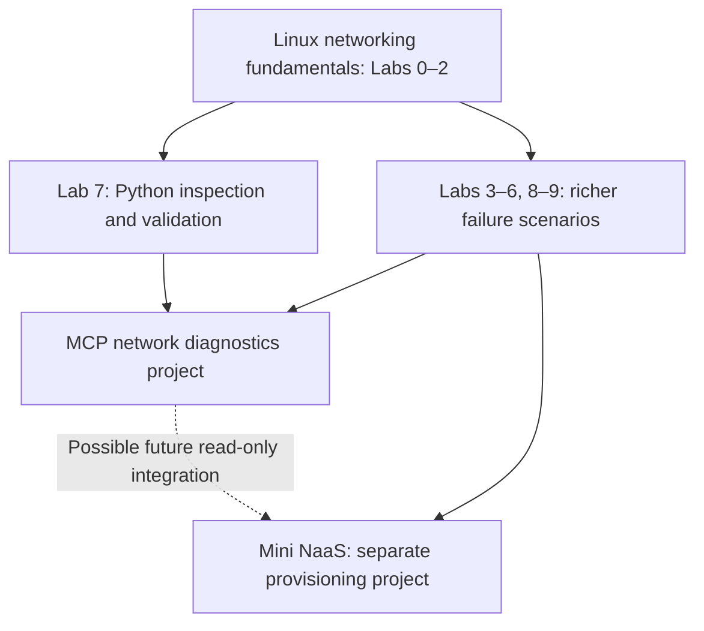
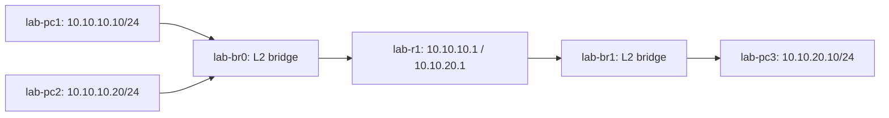
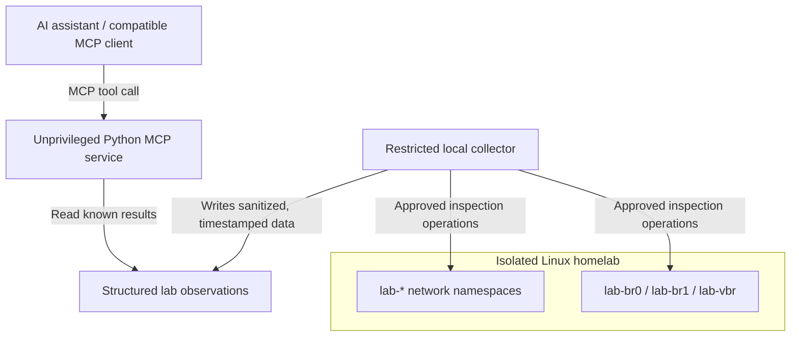

# MCP Network Diagnostics: AI-Assisted Troubleshooting on a Linux Virtual Network

**Project type:** Python/MCP, Linux networking, observability, and security portfolio project  
**Prepared for:** Marek Zarzycki  
**Revision:** 4 November 2026  
**Status:** Proposed; **not yet implemented or verified on the HP t740**  
**Recommended home:** `docs/mcp-network-diagnostics-plan.md` in [`linux-networking-homelab`](https://github.com/mazarzycki/linux-networking-homelab)  
**Target machine:** HP t740 thin client, Ubuntu Server, 8 GB RAM, 64 GB eMMC  
**Working pace:** Part-time, approximately 5–10 focused hours per week when practical

> **Core idea:** Build an MCP server that lets an AI assistant investigate failures in an **isolated Linux virtual network** using carefully scoped, evidence-producing diagnostic tools. The AI diagnoses and explains; a human controls network changes.

---

## 1. Executive summary

The project extends the existing Linux networking homelab with an AI-facing diagnostic layer. It uses the same network namespaces, `veth` pairs, Linux bridges, subnets, router, DNS, DHCP, `nftables`, VLANs, and `tc` traffic shaping already specified in the attached lab manual. A small Python Model Context Protocol (MCP) server exposes **approved inspection operations** to an AI assistant. The assistant invokes them, correlates the resulting evidence, explains likely root causes, and recommends safe, independently verifiable repairs.

This is **not** a chatbot whose answers are based only on generic networking knowledge. It will investigate real Linux kernel networking state inside a controlled topology, with measurable success and failure cases.

The first working demonstration should be narrow:

1. A real two-subnet lab is running on the Ubuntu server.
2. An MCP client discovers a small set of network-inspection tools.
3. A human deliberately removes a route **inside a lab namespace only**.
4. An AI assistant obtains current interface and route evidence, identifies the problem, and explains the suggested repair.
5. The human restores the route and reruns the same test.

The eventual portfolio story is **Python backend integration + networking fundamentals + AI tool interfaces + secure operational design**. The project may later support a service offering around enterprise AI-assisted infrastructure operations, but commercial demand remains to be validated.

## 2. Verification against the existing project documents

This plan was checked against the three supplied files:

| Supplied document | Relevant verified content | Consequence for this project |
|---|---|---|
| `README (5) (1).md` | Repository `linux-networking-homelab`; HP t740/Ubuntu Server; two-subnet topology; Labs 0–9 and capstone all marked **Not started** | Treat lab setup and results as future work, not existing functioning infrastructure |
| `lab-manual (1).md` | `lab-pc1`, `lab-pc2`, `lab-pc3`, `lab-r1`; bridges `lab-br0`, `lab-br1`; separate `lab-vbr`; specific addressing and a staged diagnostic order; Lab 7 Python validation | Reuse its names, tools, topology, Python checks, troubleshooting order and safety boundary |
| `mini-naas-plan (1) (1).md` | Separate future NaaS system with `od-*` namespace conventions, provider bridge in `od-pe`, FastAPI, PostgreSQL, Redis Streams, a privileged worker and an explicit desired-state engine | Keep Mini NaaS separate. Do not merge provisioning privileges into the AI diagnostic interface |

**Important distinction:** The documents contain an implementation design and runnable exercises, but the README does not establish that those exercises have been completed on the actual server. The Mini NaaS document additionally distinguishes checks performed in a disposable sandbox from items not yet verified on the HP t740. This MCP proposal makes no claim that the planned network or MCP service already exists.

### 2.1 Project relationship and sequencing



Mini NaaS is not a prerequisite for MCP diagnostics. The projects can share **concepts and selected unprivileged parsing/test utilities**, but their runtime responsibilities are different:

- **MCP diagnostics:** observe and explain; never reconcile or mutate the network on an AI instruction.
- **Mini NaaS:** accept explicitly authorized service orders and apply desired state via its dedicated, tightly constrained worker.

## 3. Objectives and non-goals

### 3.1 Learning objectives

- Understand MCP hosts/clients/servers, tool discovery, input/output schemas and Streamable HTTP.
- Build an MCP server in modern Python using typed schemas and useful error responses.
- Reuse the Lab 7 approach of obtaining machine-readable `iproute2` data instead of scraping human-formatted output when structured output exists.
- Understand Layer 2/3 diagnostics: links, bridges, ARP/neighbors, prefixes, routes, forwarding, DNS, firewalls and service health.
- Interpret failed probes in context; distinguish symptoms from root causes.
- Create security boundaries between an AI-facing service and privileged network namespace inspection.
- Build regression tests and a small evaluation dataset for AI-assisted diagnosis.
- Document reproducible experiments and evidence in a public portfolio without disclosing private host settings.

### 3.2 Explicit non-goals for the MVP

- No arbitrary AI-generated shell command execution.
- No AI-controlled route, firewall, DNS, DHCP, VLAN or traffic-shaping changes.
- No access to production systems, employer networks, or the household router.
- No movement, bridging or modification of the actual physical Ethernet/Wi-Fi interface.
- No changes to the Ubuntu host default route, Netplan, Tailscale or host-wide firewall as part of normal operation.
- No requirement to run a large language model locally on 8 GB RAM.
- No Docker/VM/Kubernetes requirement for the initial build.
- No claim of autonomous, production-safe incident remediation.

### 3.3 MVP definition of success

The first publishable version is successful when a compatible AI client can **reliably retrieve live or explicitly timestamped current lab evidence** and distinguish at least three injected faults (route, DNS, firewall) from a healthy baseline, without being able to change networking state.

## 4. The exact existing lab topology

The names and addresses below are copied from the attached lab manual, rather than inventing a new topology.



| Element | Namespace / interface role | Intended configuration |
|---|---|---|
| PC1 | `lab-pc1` | `10.10.10.10/24`, subnet A |
| PC2 | `lab-pc2` | `10.10.10.20/24`, subnet A; DHCP client in a later lab |
| Virtual switch A | `lab-br0` in host network namespace | Layer 2 bridge, **not** attached to physical LAN |
| Router | `lab-r1` | `10.10.10.1/24` and `10.10.20.1/24`; IPv4 forwarding inside namespace |
| Virtual switch B | `lab-br1` in host network namespace | Layer 2 bridge, **not** attached to physical LAN |
| PC3 | `lab-pc3` | `10.10.20.10/24`, subnet B; optional HTTP service on TCP 8000 |
| Lab DNS/DHCP | `dnsmasq` inside `lab-r1` | `app.lab.test` resolves to PC3; DHCP confined to lab subnet |
| Separate VLAN exercise | `lab-vbr` plus dedicated VLAN namespaces | Built separately in Lab 8; should not disrupt the main topology |

The physical HP t740 can have only one network uplink: all topology links above are virtual. Its actual physical interface name and SSH route must be **re-discovered and recorded** at Lab 0, rather than inferred from an older session or hardcoded into scripts.

### 4.1 Why the network must remain isolated

The homelab's purpose is to break routing, DNS and firewall configurations on purpose. Extending those experiments into the real LAN would create avoidable risk to the household connection and to SSH/Tailscale access. The name prefix `lab-` is useful but **not itself a security boundary**. Isolation depends on the absence of a physical uplink, scoped namespace operations and command validation.

## 5. System architecture



### 5.1 Component responsibilities

1. **AI assistant / MCP client:** Understands the user's question, discovers available tools, selects appropriate tools, compares returned evidence and produces an explanation. The assistant's conclusions are **not automatically trusted**.
2. **Python MCP server:** Publishes a small, documented tool catalog with typed parameters and structured results. Runs as an ordinary unprivileged service. It has no generic `execute_command` tool.
3. **Observation layer:** Returns network state in a consistent schema with collection timestamps, status, error reason and evidence. The initial version may read saved test fixtures; the live version reads recent observations from a tightly controlled local collector.
4. **Privileged collector:** The only component allowed to enter other network namespaces if the OS requires elevated privileges. It runs predefined inspection operations using fixed argument vectors, never a shell constructed from AI input.
5. **Virtual network:** Provides realistic, safely breakable network conditions, independent from the household network.

### 5.2 Security-driven implementation choice

Inspecting a named network namespace (for example, via `ip netns exec`) may require privileges even when the requested operation is only a read. Therefore, **do not simply run the internet-facing MCP server as root**.

Suggested sequence:

- **Prototype:** MCP server reads version-controlled sample JSON fixtures. This proves tool schemas and client integration without privileges.
- **First real lab integration:** An operator-controlled, root-owned collector gathers approved read-only state and atomically writes sanitized JSON snapshots with timestamps into a directory readable by the unprivileged MCP service.
- **Advanced optional design:** Replace periodic snapshots with a local-only Unix-socket helper that accepts a closed set of typed inspection requests, validates every field, returns structured output and logs invocations. Restrict its peer access. Do not create a remotely reachable root helper.

This trades instant freshness for an easier-to-audit first security boundary. Any response using a cached snapshot **must report when the data was collected**; stale data must not be presented as live.

### 5.3 Transport and network exposure

- Use the official MCP Python SDK v2 and its `MCPServer` interface (verify installed package version before coding).
- Start with a local client / local `stdio` workflow where practical, or Streamable HTTP bound to `127.0.0.1` on the Ubuntu server.
- If the assistant runs on a different computer, use an authenticated SSH tunnel to the loopback HTTP endpoint for development.
- Never expose an unauthenticated MCP service to the public Internet or directly to the household LAN.
- In a later remote-access phase, add TLS, OAuth-based authorization, an explicit identity/role policy, rate limits and audit logs before broadening access. Tailscale alone does not replace tool-level authorization.
- Keep the home server's SSH, Tailscale and network configuration outside the experiment.

**Note:** Streamable HTTP is the recommended modern remote transport. The older HTTP+SSE transport should not be chosen for a new project. Client support and actual protocol versions should be verified during integration testing.

## 6. Proposed MCP tool catalog

Build tools incrementally; do not publish all of these before the first successful end-to-end diagnosis.

### 6.1 Core tools: required for MVP

| Tool name | Inputs | Output | Underlying inspection |
|---|---|---|---|
| `list_lab_nodes` | None | Allowed namespaces, available lab bridges, snapshot timestamp | Fixed inventory of `lab-*` objects |
| `get_interfaces` | `node`: allowed namespace | Interfaces, addresses, operstate, MTU | `ip -j -n NAME addr/link` via collector |
| `get_routes` | `node`: allowed namespace | Destination, gateway, device, protocol, metric | `ip -j -n NAME route` |
| `get_neighbors` | `node`: allowed namespace | IP/MAC neighbor state | `ip -j -n NAME neigh` |
| `get_router_forwarding` | None | IPv4 forwarding state in `lab-r1` | Read router namespace sysctl |
| `get_bridge_state` | `bridge`: `lab-br0` or `lab-br1` | Bridge ports, operational state, possibly forwarding database | Approved `bridge` / `ip` inspection |

### 6.2 Next tools: add when matching labs are complete

| Tool name | Prerequisite | Inputs | Evidence returned |
|---|---|---|---|
| `check_connectivity` | Labs 1–2 | Enumerated `source`, named allowed destination, probe type | Bounded ICMP/TCP result, RTT/error, timestamp; controlled active probe, no configuration change |
| `resolve_lab_name` | Lab 3 | Name allowlisted under `.lab.test` | Resolved A records and error state from lab DNS |
| `get_dns_service_status` | Lab 3 | None | Listener/service status for lab `dnsmasq`, not host DNS configuration |
| `get_lab_dhcp_state` | Lab 4 | None | Redacted lease summaries and selected lab-only DHCP observations |
| `get_firewall_rules` | Lab 6 | None | Relevant `nftables` rules **inside `lab-r1` only** |
| `get_tcp_listeners` | Lab 6 | Allowed destination namespace | Lab TCP listening sockets / ports |
| `get_vlan_membership` | Lab 8 | Allowed lab bridge/port | Tagged/untagged VLAN membership from dedicated VLAN lab |
| `get_traffic_shaping` | Lab 9 | Allowed namespace/interface | Qdisc, configured rate and counters from `tc -j` |

No model-provided free-text shell commands, host paths, device names, IP ranges or URLs should become executable instructions. Even diagnostic targets need bounds: named lab endpoints only; no scanning arbitrary home or public addresses. Rate-limit active probes, enforce short timeouts and cap response sizes.

### 6.3 Example structured result

An example **illustrative schema**, not evidence from the real server:

```json
{
  "tool": "get_routes",
  "node": "lab-pc3",
  "observed_at": "2026-11-04T12:00:00Z",
  "source": "collector-snapshot",
  "freshness_seconds": 3,
  "ok": true,
  "routes": [
    {
      "destination": "10.10.20.0/24",
      "gateway": null,
      "interface": "lab-p3"
    }
  ]
}
```

The absent default route in this example would be a **clue** to a return-path problem, not proof by itself. A careful diagnosis also checks the intended topology and packet path.

### 6.4 Proposed input validation

- `node` is an enum drawn from `lab-pc1`, `lab-pc2`, `lab-pc3`, `lab-r1`, with a separate approved list for any VLAN namespaces added later.
- `bridge` is an enum drawn from `lab-br0`, `lab-br1`, and—only after Lab 8—`lab-vbr`.
- Destination names are resolved from fixed lab inventory; no arbitrary public target, wildcard or shell string.
- Probe count, concurrency and timeouts have conservative fixed maxima.
- Collector commands are constructed as **constant argument arrays**, with no `shell=True`, command interpolation or user-defined binary name.
- Privilege checks apply on the server/helper side, not only in prompt instructions.

## 7. Diagnostic method: evidence before conclusions

The AI assistant should follow the troubleshooting order already defined in the lab manual's section 10.1:

1. Link existence and `UP` state.
2. VLAN membership, when relevant.
3. IP address and prefix.
4. Local neighbor/ARP resolution.
5. Source and return routes.
6. Router forwarding and firewall rules.
7. DNS resolution.
8. Listening service and application-layer reachability.
9. Performance and traffic shaping.

Every diagnosis should state:

- **Symptom:** What was observed, rather than assumed.
- **Evidence:** Specific tool result(s), node, command category and observation time.
- **Hypothesis:** Which fault best explains the evidence.
- **Confidence/uncertainty:** What is not yet checked; do not invent a numeric probability.
- **Safe next check:** Another read-only tool or a human-run verification step.
- **Suggested repair:** A clear manual action, explicitly separated from actions the AI is allowed to take.
- **Retest:** Expected observation after the human's repair.

### 7.1 Example incident: return route missing

**Baseline:** `lab-pc1` should reach the HTTP service at `lab-pc3` via `lab-r1`.

**Fault injection:** A human, following the manual's capstone, removes the relevant return route from `lab-pc3` **inside that lab namespace**.

**User asks:** "PC1 can't reach the app on PC3. Find out why."

**Assistant investigation:**

1. Read `lab-pc1` interface and route state.
2. Read router interfaces, routes and forwarding setting.
3. Read `lab-pc3` interface and routes.
4. Compare the observed return path with the intended gateway `10.10.20.1`.
5. Identify the missing route, cite the evidence and recommend a **human-operated** correction.
6. After the human changes the isolated lab, recheck routing and bounded connectivity.

**Success:** The explanation cites the correct host, route and network direction, without offering an unsafe host-wide route command.

### 7.2 Example incident: DNS versus network reachability

**Symptom:** `app.lab.test` fails, but `10.10.20.10` responds by IP.

**Assistant investigation:** Compare name lookup through `10.10.10.1` with direct IP connectivity, check the lab `dnsmasq` service and the returned record. Diagnose DNS separately from routing and HTTP.

**Success:** The model does not assert that DNS is broken merely because a TCP service is down, or that routing is broken merely because a name fails to resolve.

### 7.3 Example incident: firewall versus service

**Symptom:** ICMP works across subnets but TCP port 8000 times out.

**Assistant investigation:** Confirm `lab-pc3` is listening on TCP 8000, then inspect only `lab-r1`'s `nftables` forward rules and compare with a bounded TCP probe.

**Success:** Distinguishes an intentionally blocked port from an application that is not listening.

## 8. Implementation roadmap

Effort estimates below are planning assumptions, **not deadlines**. The existing README marks all labs as not started, so finish the needed foundation before claiming completion of any MCP phase. A lightweight MCP proof of concept can be developed against fixtures in parallel.

### Phase 0 — Foundation and baseline (prerequisite)

**Do:**

- Complete **Lab 0** and record real host interfaces, default route, SSH/Tailscale access, Docker presence and actual installed versions.
- Complete **Labs 1–2**: `lab-pc1`, `lab-pc2`, `lab-pc3`, two bridges, `lab-r1`, subnets, inter-subnet routing.
- Capture healthy output from `ip -j`, `bridge` and bounded pings; keep timestamps.
- Complete the relevant portion of **Lab 7** to understand Python collection and structured validation.
- Confirm the host's original route and management connectivity remain intact after experiments.

**Done when:** A manually verified, safely isolated two-subnet topology exists, and baseline JSON fixtures are available for tests. Record actual results; don't simply check boxes because commands were copied.

### Phase 1 — Python diagnostics library (approximately 1–2 weeks)

**Do:**

- Build pure Python parsers and typed models for interface, route and neighbor JSON.
- Implement the core, read-only inventory and route-validation functions.
- Define input enums, normalized error messages, timestamps and output schemas.
- Write unit tests using captured or synthetic healthy/faulty fixtures.
- Keep collection separate from interpretation and separate from any privileged operation.

**Done when:** Unit tests identify an incorrect/missing default route in fixture data and reject an unknown namespace or field.

### Phase 2 — Local MCP prototype (approximately 1 week)

**Do:**

- Create an MCP server using the official Python SDK v2.
- Expose `list_lab_nodes`, `get_interfaces`, and `get_routes` using fixture-backed adapters.
- Inspect available tools with a compatible MCP client or Inspector.
- Verify schema validation, tool errors, absent data and human-readable descriptions.
- Verify the model cannot discover or invoke a general shell-execution tool.

**Done when:** A client can list tools, invoke them with valid parameters and get typed results; invalid namespace requests fail deterministically.

### Phase 3 — Real homelab observations (approximately 1–2 weeks)

**Do:**

- Add a narrowly scoped, root-owned **read-only** collector with a fixed allowlist of observations inside the specified lab namespaces.
- Atomically publish redacted, timestamped snapshots to a restricted local directory.
- Run the MCP server unprivileged and make it consume the snapshots.
- Add stale-observation reporting and explicit failure when the collector cannot access a namespace.
- Exercise missing route and other faults from the existing manual; confirm no host route or interface is touched.
- Test the complete chain from a local client (or an SSH-tunneled client).

**Done when:** The assistant reports the observed lab fault accurately, with timestamps, while the MCP service has no direct privileged network-control capability.

### Phase 4 — Richer networking and evaluations (approximately 1–3 weeks)

**Do:**

- Complete Labs **3, 5 and 6** to support DNS, packet inspection and firewall faults; Lab 4 for DHCP as needed.
- Extend tools for DNS, router firewall and service state.
- Create golden test cases corresponding to the manual's capstone.
- Measure tool correctness separately from the assistant's diagnosis quality.
- Require the assistant to support its conclusion with actual tool evidence.
- Add bounded active probes only after the authorization/validation boundary is reviewed.

**Done when:** The first three incident types (return route, wrong DNS record, TCP firewall block) are reproducible, detectable and distinguishable from the healthy baseline.

### Phase 5 — Networking depth and portfolio publication (optional, approximately 1–3 weeks)

**Do:**

- Complete Lab **8** and add VLAN state inspection for the separate `lab-vbr` environment.
- Complete Lab **9** and add shaping state/throughput interpretation.
- Run the full six-fault capstone with AI-assisted diagnosis, then compare against your own independent analysis.
- Add tests, CI, architecture and threat-model documentation, concise demo recording and a clearly marked status matrix.
- Publish only sanitized lab data and demo output.

**Done when:** A reader can reproduce the demo from documented prerequisites and can inspect both successful and failed diagnoses.

### Optional Phase 6 — More enterprise-like integration

- Add OAuth-based authentication, per-user scopes, request quotas, structured audit logs and a supported remote deployment pattern.
- Add metrics/traces (OpenTelemetry) and health checks.
- Study Entra ID and Azure API Management's ability to expose/govern MCP tools.
- Create an **independent** Azure Monitor adapter or an approved read-only adapter to Mini NaaS's API, without sharing the privileged provisioning worker.
- Perform a security review and a cost/operational assessment before allowing outside access.

This is a stretch phase, not required to prove the networking/MCP concept.

## 9. Security and threat model

| Threat or failure | Mitigation and requirement |
|---|---|
| AI chooses a destructive operation | No write tools in MCP; network configuration changes remain manual |
| Prompt injection tries to make tools execute a command | No generic shell tool; fixed server-side operation list; treat model text and tool data as untrusted |
| User supplies `node=eth0` or a real gateway | Reject any value outside a strict lab inventory; no physical interface names accepted |
| Privileged collector executes arbitrary arguments | Root-owned collector, typed operations, exact argv shapes, no `shell=True`, constrained local access and audit |
| Diagnostic endpoint exposed outside intended boundary | Loopback binding; SSH tunnel during development; TLS/OAuth/permissions before remote deployment |
| Snapshot misrepresented as live | `observed_at`, freshness/age and stale-data errors |
| Probe overwhelms a target | Fixed target set, low count, short timeout, concurrency and rate limits |
| Sensitive system information leaks into prompts | Redact private host data and credentials; collect only isolated synthetic lab information |
| Network setup disrupts household LAN | Never attach real uplink to bridge, move physical NIC or change host default route; baseline/after checks |
| Docker changes forwarding behavior on host bridges | Follow manual section 0.3: inspect and test first, apply only specifically justified exceptions |
| Lab network objects collide with Mini NaaS | Keep `lab-*` and `od-*` inventories, permissions and lifecycle separate |
| Overprivileged MCP process | Run unprivileged, consume snapshots or narrowly scoped local helper rather than running MCP itself as root |

**Special warning:** `ip -n` and `ip netns exec` work on named namespaces, but their correct use depends on privileges and exact argument shape. A simple string prefix check is not sufficient. The existing Mini NaaS plan documents why accepting arbitrary trailing arguments can be dangerous. Reuse its *security principle*, not its root provisioning powers.

## 10. Test and evaluation strategy

Test four distinct layers:

1. **Parsers and models:** Given JSON fixture A, does `get_routes` return the expected typed routes?
2. **MCP boundary:** Can tools be discovered? Are invalid enum values rejected? Do oversized requests and stale snapshots fail safely?
3. **Collector boundary:** Are only approved `lab-*` observations possible? Does the collector refuse unknown commands/targets? Is the MCP process unprivileged?
4. **Diagnostic quality:** Does the AI identify the intended root cause and cite supporting observations, rather than guessing from the user prompt?

### 10.1 Golden diagnostic dataset

| ID | Scenario | Expected root cause | Minimum supporting evidence | Progression |
|---|---|---|---|---|
| H0 | Healthy network | No fault | Correct addresses, routes, successful bounded connectivity | MVP |
| R1 | Missing PC3 return route | Missing route via R1 on subnet B | `lab-pc3` route table and return-path reasoning | MVP |
| R2 | Missing PC1 default route | Source has no route to subnet B | `lab-pc1` route table | MVP |
| D1 | Wrong `app.lab.test` A record | Incorrect DNS mapping | DNS answer versus expected `10.10.20.10` | After Lab 3 |
| F1 | TCP 8000 blocked in R1 | Forward-chain rule drops traffic | Successful IP reachability + listener + relevant rule | After Lab 6 |
| S1 | Web service stopped | Nothing listening on destination port | TCP failure + `lab-pc3` listener check | After Lab 6 |
| V1 | VLAN removed from trunk | Missing VLAN membership | VLAN access/trunk inspection | After Lab 8 |
| V2 | Access port in wrong VLAN | Port VLAN mismatch | `bridge vlan show` state | After Lab 8 |
| P1 | Misconfigured 5 Mbit/s shaper | `tc` rate too low | Qdisc counters and throughput comparison | After Lab 9 |

The README/manual capstone includes six injected faults: PC3 return route, DNS record, TCP 8000 firewall, trunk VLAN, access VLAN, and bandwidth shaping. Treat these as the **primary end-to-end benchmark**. H0/R2/S1 are additional negative controls to prevent overfitting to the six known answers.

### 10.2 Evaluation criteria

For each incident, record independently:

- Did every invoked tool return technically correct and appropriately scoped data?
- Did the model identify the correct affected component and layer?
- Did it cite real evidence instead of inventing measurements?
- Did it avoid a premature conclusion when evidence was inconclusive?
- Did it suggest only reversible, manually approved lab changes?
- Was the network healthy after the human's repair and retest?
- Did host baseline checks remain unchanged?

Keep transcripts and machine results for both successes and failures. A good portfolio records limitations; do not claim perfect accuracy based on one run of each fault.

### 10.3 Automated tests

- `pytest` for normalization, schema validation, whitelists, missing/invalid JSON and timeouts.
- Contract tests for MCP tool names, descriptions, input schemas and output fields.
- Privilege-boundary tests, including adversarial inputs such as `../../`, `;`, unknown namespace names, oversized labels and wildcards.
- Optional privileged integration tests executed **explicitly** on the isolated host, never automatically from ordinary CI.
- GitHub Actions for fixture-backed unit tests and static checks, with no access to home network secrets.

## 11. Suggested repository organization

Start with a subproject in `linux-networking-homelab`. There is no need to create a separate commercial product repository now.

```text
linux-networking-homelab/
├── README.md
├── docs/
│   ├── lab-manual.md
│   ├── mini-naas-plan.md
│   ├── mcp-network-diagnostics-plan.md     # this document
│   └── mcp-lab-journal.md                  # create as testing progresses
└── mcp-network-diagnostics/               # future implementation
    ├── README.md
    ├── pyproject.toml
    ├── src/network_mcp/
    │   ├── server.py                       # MCP tool definitions (unprivileged)
    │   ├── models.py                       # validated input/output schemas
    │   ├── inventory.py                    # approved lab names and targets
    │   ├── diagnostics.py                  # normalized observation logic
    │   ├── snapshots.py                    # freshness and typed snapshot reader
    │   └── collector/                      # separately deployed, restricted helper
    ├── tests/
    │   ├── fixtures/                       # synthetic or sanitized lab output
    │   ├── test_models.py
    │   ├── test_tools.py
    │   ├── test_security.py
    │   └── test_diagnoses.py
    └── examples/
        ├── example_tool_results.json
        └── demo_scenarios.md
```

The tree is a **proposed layout**, not an assertion that these directories exist. The existing README points to `docs/lab-manual.md` and `docs/mini-naas-plan.md`; keep those files and the separate Mini NaaS plan unchanged unless explicitly revising the repository.

### 11.1 Documentation expected in a polished portfolio

- Overview explaining the user's problem and why MCP is appropriate.
- Architecture diagram showing MCP client, unprivileged server, collector boundary and lab namespaces.
- Setup prerequisites, versions and actual verification status.
- Tool catalog with input/output examples and security restrictions.
- A short demonstration with one healthy case and at least three faults.
- Test matrix, results, known failures and next improvements.
- Security assumptions and a clear statement that the lab is isolated, not enterprise production software.

## 12. Observability and operating practices

- Log `request_id`, `tool_name`, source identity (if authenticated), approved target, duration, result status and diagnostic snapshot timestamp.
- Never log credentials, access tokens, sensitive raw responses or unrestricted tool arguments.
- Separate MCP request logs from privileged collector logs; use a correlation ID where possible.
- Define health checks for the MCP process and collector freshness separately.
- Apply timeouts so a stuck probe cannot block an assistant indefinitely.
- Record whether a topology was running, stopped, or partially configured during a test.
- Maintain a lab journal with the exact injected fault, observed evidence, explanation, manually applied fix and cleanup proof.

## 13. Hardware, deployment and resource constraints

| Concern | Approach |
|---|---|
| 8 GB RAM | Network namespaces, Python collector and MCP server are lightweight; no local large model required |
| 64 GB eMMC | Limit packet-capture sizes, logs, Python environments and retained traces; watch disk space |
| One physical Ethernet port / possible Wi-Fi management | Virtual `veth`/bridges need no extra NICs; preserve whichever physical uplink is actually active |
| Ubuntu Server | Use the current kernel's namespace, bridge and netfilter facilities; verify versions in Lab 0 |
| Docker | Not required initially; respect existing manual's warning about Docker firewall interaction with host-namespace bridges |
| Remote testing | Prefer SSH-tunneled loopback MCP access rather than making the service Internet reachable |
| AI cost | Use a compatible hosted assistant/model for demos; monitor provider limits and avoid unnecessary repeated calls |

## 14. Risks, scope control and decision points

| Risk | Practical response |
|---|---|
| Getting distracted before fundamentals are learned | Finish Labs 0–2 and a basic Lab 7 validator before live MCP integration |
| Building too many tools | Ship inventory + interfaces + routes first; expand only for a real fault case |
| Confusing automation with comprehension | Diagnose faults manually first, then compare the AI's diagnosis |
| Security design becoming the entire project | Use sanitized fixtures then a periodic collector before attempting a sophisticated live helper |
| Overlapping Mini NaaS implementation | Keep MCP read-only; isolate `lab-*` vs `od-*`; no shared privileged worker |
| Tool/schema churn in rapidly evolving MCP ecosystem | Pin dependency versions and test client interoperability; favor official SDK/docs |
| Endless portfolio polishing | Publish a narrow working demo and list limitations; do not wait for Azure, OAuth and every Lab 8/9 feature |

**Scope rule:** If progress stalls, reduce the number of tools or faults, **never** reduce the privilege boundary or isolation checks to save time.

## 15. Potential business relevance (hypothesis, not a validated product)

The portfolio could eventually support a specialized service proposition: **secure AI integrations for infrastructure operations**.

Possible business-oriented extensions:

- Read-only diagnostics over existing monitoring/APM data and approved inventory APIs.
- Tool discovery and access controls for company-internal operations APIs.
- Evidence-linked incident summaries and troubleshooting guidance.
- MCP gateways in front of existing APIs, with per-user permissions, audit logs and observability.
- Integration testing, maintenance and security review of an organization's AI tool surface.

What would require additional expertise and customer validation: enterprise identity integration, privacy/security contracts, reliability SLAs, multi-tenant isolation, operational support, internal data access, audit requirements and sales. Building this homelab does **not** establish market demand or production readiness, but it demonstrates relevant engineering judgment.

## 16. Completion and publication checklist

### Essential

- [ ] Lab 0 baseline captured without changing host management connectivity.
- [ ] Main two-subnet topology built and manually verified on HP t740.
- [ ] Lab 7-style Python JSON parsing works with unit tests.
- [ ] MCP server advertises 3–4 clearly documented read-only tools.
- [ ] Unknown target and command-injection attempts are rejected.
- [ ] Unprivileged MCP process cannot configure networking.
- [ ] Real observations have timestamps, freshness checks and error states.
- [ ] Healthy baseline and route-fault diagnosis demonstrated.
- [ ] DNS and firewall fault scenarios demonstrated, or explicitly listed as pending.
- [ ] Host physical interface, default route and SSH/Tailscale access remain intact.
- [ ] Public README, sample outputs, tests, diagrams and limitations are accurate.

### Optional

- [ ] VLAN membership inspection and two VLAN capstone faults.
- [ ] Traffic-shaping inspection and bandwidth capstone fault.
- [ ] Local helper over a restricted Unix socket replaces periodic snapshots.
- [ ] OpenTelemetry tracing and request correlation.
- [ ] Authenticated remote access after security review.
- [ ] Azure Monitor or separate read-only Mini NaaS integration.
- [ ] Recorded short demonstration comparing manual and AI diagnoses.

## 17. References

### Existing homelab materials (source of topology and scope)

1. Supplied `README (5) (1).md` — repository overview, status and safety boundary.
2. Supplied `lab-manual (1).md` — especially sections 0, 1–3, 6–7, 10 and 12.
3. Supplied `mini-naas-plan (1) (1).md` — especially sections 4.2, 9.1–9.3, 14 and Appendix B.
4. Public repository: https://github.com/mazarzycki/linux-networking-homelab

### Official technical references

- MCP specification: https://modelcontextprotocol.io/
- MCP Python SDK v2 and examples: https://py.sdk.modelcontextprotocol.io/
- MCP Python SDK on GitHub: https://github.com/modelcontextprotocol/python-sdk
- MCP server transport documentation: https://py.sdk.modelcontextprotocol.io/run/
- MCP authorization guidance: https://py.sdk.modelcontextprotocol.io/run/authorization/
- Linux `network_namespaces(7)`: https://man7.org/linux/man-pages/man7/network_namespaces.7.html
- Linux `ip-netns(8)`: https://man7.org/linux/man-pages/man8/ip-netns.8.html
- Linux `veth(4)`: https://man7.org/linux/man-pages/man4/veth.4.html
- Python `subprocess`: https://docs.python.org/3/library/subprocess.html
- Azure API Management MCP overview (future phase): https://learn.microsoft.com/azure/api-management/mcp-server-overview

---

**Bottom line:** The best first outcome is a **reproducible, read-only, evidence-driven AI diagnostic assistant for your existing virtual Linux network**. It should deepen networking skills, demonstrate Python/MCP competence, and show disciplined security boundaries. Mini NaaS can remain a separate project focused on provisioning and desired-state automation.
